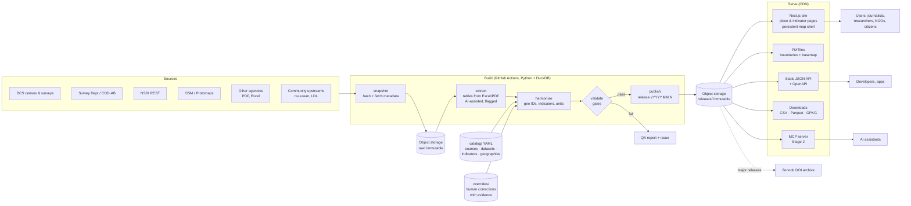
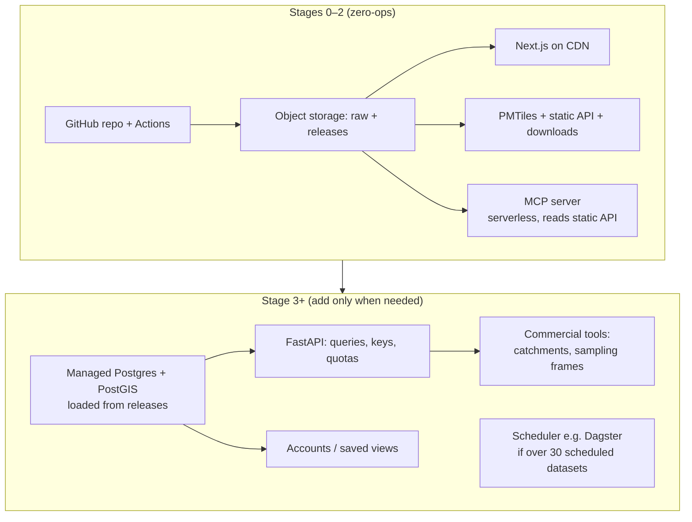

# Architecture overview

Status: **proposed** · 2026-11-07 · Related: [data-model.md](data-model.md) · [technology-choices.md](technology-choices.md) · [decision-log.md](../decisions/decision-log.md)

This architecture is designed for one product/research lead directing AI coding agents, on a self-funded budget. It also has to be able to grow into national infrastructure without a rewrite.

---

## 1. Design principles

1. **Small data, high trust.** Everything Sri Lanka Facts publishes for years will fit in a few gigabytes. Optimise for provenance, reproducibility and review, not throughput.
2. **Releases are the source of truth.** Each published number belongs to an immutable, versioned release built by a pipeline from hashed raw snapshots. Databases, when they arrive, are caches loaded from releases that can be rebuilt at any time.
3. **Everything important is reviewable text.** Source metadata, indicator definitions, geography crosswalks and human corrections live as YAML/CSV in Git. A non-coding lead reviews *diffs and evidence*, not code internals. AI agents work safely in branches.
4. **Static-first; add services only when they are needed.** Pages, tiles, downloads and the first API are files on a CDN, so there are no servers to patch in Stages 0–2. Add a database or API service only for a concrete need: queries, keys, accounts.
5. **One language per layer.** Python for data, TypeScript for web. Fewer tools mean fewer agent mistakes.
6. **Mobile-first performance budget.** Most Sri Lankan users are on phones ❓ (assumption; verify with analytics). Every page must be usable without WebGL.
7. **Open formats.** Parquet/GeoParquet, CSV, GeoPackage, PMTiles and JSON. No lock-in to a vendor database.
8. **Map-first, not map-only.** A persistent map shell around real, server-rendered pages (D-002).

---

## 2. System context



---

## 3. The data pipeline

The stages follow Our World in Data's proven snapshot → meadow → garden pattern 🟡, renamed so they are self-explanatory.

| Stage | Input → output | Rules |
|---|---|---|
| **snapshot** | Source URL or file → `raw/{source}/{dataset}/{retrieved_at}/{file}` plus a `.meta.json` (URL, retrieved_at, sha256, HTTP headers, licence note) | Never modify. Never delete. One snapshot per retrieval. Deduplicate by hash. |
| **extract** | Raw file → tidy table(s) in the source's own terms (its codes, names, units) | Deterministic parsers first (openpyxl, pdfplumber/camelot, Docling). An LLM is a fallback for hard PDFs. All machine-extracted values are `verification: machine_extracted` until checked. |
| **harmonise** | Tidy source table → SLF observations (`geography_id`, `indicator_id`, `period`, `value`, `unit`, attributes) | Uses `catalog/` crosswalks and indicator definitions. Applies `overrides/` with a recorded reason. Unmatched units fail loudly. Nothing is dropped silently. |
| **validate** | Observations + geography → pass/fail + QA report | Schema; hierarchy sums (GN → DS → district → province → country within a stated tolerance); totals match official published totals; ranges; coverage; duplicates; unit sanity; year-on-year jumps flagged; licence present. |
| **enrich** | Validated observations + spine → spatial context and place vectors | Neighbours, local cluster/outlier statistics, smoothed rates (labelled `modelled_estimate`), profile vectors, similar places. Reads only validated data; never changes observations. See [spatial-first-analytics.md](spatial-first-analytics.md) (D-015). |
| **publish** | Validated data → release `vYYYY.MM.N` | Parquet + CSV + GeoPackage + JSON API files + PMTiles + `datapackage.json` (Frictionless) + `CHANGELOG` + checksums. Immutable. `latest` is a pointer. |

**Orchestration:** a small Python CLI (`slf snapshot census-2024`, `slf build`, `slf release`) run locally or by GitHub Actions on a schedule or manual trigger. Each dataset is a module with the same five functions. There is no scheduler service until more than about 30 datasets need independent schedules. Then evaluate Dagster (see technology-choices).

**Human-in-the-loop verification:** for key indicators, the pipeline produces a *verification sheet* (CSV/HTML): each value beside the source page or cell reference and a cropped image of the PDF table. You tick, correct or reject. Corrections go to `overrides/` with evidence, and the value's `verification` becomes `human_verified`. Prompt D02 defines this.

---

## 4. Repository layout (planned)

One monorepo keeps context in one place for AI agents.

```
srilankafacts/
├── AGENTS.md              # standing rules for AI agents (CLAUDE.md imports it)
├── README.md
├── catalog/               # reviewed metadata, YAML
│   ├── sources/           # one file per publisher/source
│   ├── datasets/          # one per dataset: source, licence, schedule, pipeline module
│   ├── indicators/        # definitions, units, methodology notes, topics
│   └── geographies/       # schemes, vintages, crosswalks (CSV)
├── overrides/             # human corrections: CSV + reason + evidence link
├── pipeline/              # Python package (uv), tests
│   ├── slf/               # cli, snapshot/, extract/, harmonise/, validate/, publish/
│   ├── datasets/          # one module per dataset
│   └── tests/
├── tiles/                 # tile build recipes (tippecanoe configs, basemap extract)
├── web/                   # Next.js app (TypeScript)
├── docs/                  # these documents, prompts, decisions
└── .github/workflows/     # CI: lint, test, build, release, deploy
```

`data/` (local working copies) and all raw and release artefacts are **not** in Git. They live in object storage. Small reference CSVs such as crosswalks are in Git.

---

## 5. Serving the product

### 5.1 Web application

- **Next.js (App Router, TypeScript)**, mostly static generation, with on-demand revalidation for long-tail pages.
- **Persistent map shell:** a layout-level client component holds one MapLibre instance. Navigating between `/place/LK11` and `/place/LK1103` keeps the map mounted and *flies* between places, while each route renders its own server-side content (title, key numbers, table, sources). This keeps the "map as base layer" feel while every place has a real URL with HTML that search engines and screen readers can read.
- **Routes (initial):** `/` (hero map + entry points) · `/place/[geoId]` · `/indicator/[indicatorId]` · `/explore` (full-screen explorer with URL state) · `/data` (downloads, API docs) · `/methods` · `/sources/[sourceId]` · `/corrections` · `/stories/[slug]`.
- **Lite mode:** if WebGL is unavailable, `Save-Data` is on or the device is low-memory, show a pre-rendered static map image and the data table instead of the WebGL map.

### 5.2 Maps

- **Boundaries:** PMTiles per level (province, district, DS, GN; later LA, ED/PD, MOH), built with Tippecanoe. Each feature carries `geography_id` as its feature ID and minimal properties (name only).
- **Indicator values are not baked into tiles.** The client fetches a small JSON or Arrow file per indicator and level (for example 14,000 GN values ≈ 100–200 kB gzipped ❓ estimate) and colours features using MapLibre `feature-state`. Data updates never require rebuilding tiles, and tiles change only when boundaries change.
- **Basemap:** a Sri Lanka extract of the Protomaps basemap (PMTiles) on our own storage, styled to the brand. No dependency on a third-party tile service. ODbL attribution shown.
- **Zoom-dependent detail:** GN geometry from about zoom 10. Simplified district and DS geometry at national zoom.
- **Later:** deck.gl for heavy point layers or 3D. Martin (Rust tile server over PostGIS) only if dynamic tiles become necessary.

### 5.3 Downloads and API

- **Stage 1: static API.** Versioned JSON files: `/api/v1/places/{geoId}.json`, `/api/v1/indicators/{id}.json`, `/api/v1/indicators/{id}/{level}.json`, `/api/v1/geographies/{scheme}.json`, plus `/api/v1/releases/latest.json`. Documented with an OpenAPI file. Served from CDN with CORS open and long cache lifetimes per release.
- **Downloads:** per dataset (CSV, Parquet), boundaries (GeoPackage, GeoParquet), full release bundle (zip + `datapackage.json`).
- **Stage 2: power explorer.** DuckDB-WASM in the browser querying release Parquet directly, for filters and SQL with no server.
- **Stage 3+: dynamic API.** FastAPI over managed Postgres/PostGIS loaded from releases, for arbitrary filters, point-in-polygon at any scheme, bulk queries, API keys and quotas (commercial tiers).

### 5.4 Search

- Place search: a compact trilingual index (names, alternate spellings, parent names) loaded on demand. Around 15,000 entries fits comfortably client-side.
- Content search: Pagefind (static index built at deploy).
- Later: Postgres full-text or Typesense when content grows.

### 5.5 AI surfaces

- **Internal (Stage 0+):** PDF/Excel extraction assistance, name matching and transliteration suggestions (always human-reviewed), QA anomaly explanations, drafting explainers with citations.
- **External (Stage 2):** an **MCP server** exposing `search_places`, `get_place_profile`, `get_indicator`, `get_sources`, with every response carrying source and release citations. Also `llms.txt` and an AI-friendly API description.
- **Public evaluation set:** questions answerable from SLF data with exact expected values, used to test our MCP and any future AI features.

---

## 6. How the architecture evolves



**Triggers for adding a component:**

| Component | Add when | Not before |
|---|---|---|
| Postgres/PostGIS | Paying users need arbitrary spatial queries, or accounts are needed | Stage 3 |
| FastAPI service | The static API can't answer real user requests, or keys and quotas are needed | Stage 3 |
| Scheduler (Dagster) | More than 30 datasets on independent schedules, or GitHub Actions limits hurt | Stage 3+ |
| Redis / queues | Never by default. Only for a measured need. | — |
| GeoServer / OGC | A government or GIS client needs WMS/WFS | Stage 4, if ever |

---

## 7. Hosting and cost (Stages 0–2)

| Need | Recommended | Indicative cost ❓ (verify current pricing) |
|---|---|---|
| Code, CI, issues | GitHub (Actions minutes on free tier for public repos) | 0 |
| Raw snapshots, releases, tiles | Cloudflare R2 (no egress fees) | ~USD 0–5/month at our size |
| Web app | Vercel Pro (Hobby is non-commercial only), or Cloudflare Workers via OpenNext | ~USD 20/month (Vercel Pro) or ~0–5 |
| DNS, CDN, WAF | Cloudflare | 0 |
| Analytics | Cloudflare Web Analytics or self-hosted Umami/Plausible | 0–9 |
| Uptime and alerts | A free uptime monitor plus GitHub Actions failure emails | 0 |
| Archival DOI for major releases | Zenodo | 0 |
| AI agent usage | Claude subscription or API | Your largest running cost. Budget it explicitly. |

---

## 8. Security and privacy

- Mostly static, so the attack surface is small. No user data collected until accounts exist (Stage 3+).
- Secrets live only in GitHub Actions environments. Object-storage write keys are scoped to CI. Use protected branches and required checks.
- Dependabot or Renovate. `pip-audit` and `pnpm audit` in CI. Pin GitHub Actions to commit hashes.
- Security headers (CSP, HSTS, frame-ancestors restricted except on embed routes). CORS open only on API and tiles.
- Privacy-friendly analytics, no third-party trackers. Privacy policy aligned with the PDPA before any sign-up form (core provisions from 1 Jan 2027 🟡).
- Release integrity: checksums in every manifest. Releases are immutable, so a "correction" is a new release plus a corrections-log entry.

---

## 9. Quality gates (what "done" means technically)

- The pipeline is reproducible from raw snapshots on a clean machine (`slf build --from-scratch`).
- Each dataset has tests: schema, hierarchy sums, official totals, coverage, licence present.
- Each release has a QA report and changelog. Values shown in the UI resolve to a release and source.
- Web: Lighthouse/CrUX budgets (see W01), accessibility checks (Q03), and an e2e smoke test of key journeys (Playwright).
- Every change by an agent comes with evidence: commands run, real output, screenshots for UI, and a list of what was *not* verified.
