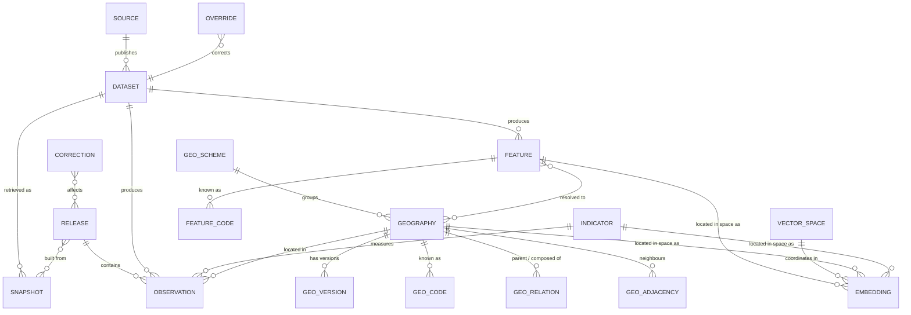

# Data model

Status: **proposed** · 2026-11-07 · Builds on brainstorm §4 and §15 · Related: [architecture-overview.md](architecture-overview.md)

Every observation is a box in space, time and meaning: a **where** (footprint), a **when** (time footprint) and a **what** (indicator and breakdown), with a value and its provenance ([footprint-model.md](footprint-model.md), D-018). The model has four parts (plus a derived fifth, the **vector spaces**, in which every entity has coordinates; see [vector-space-model.md](vector-space-model.md)): **catalogue** (where data comes from and what we may do with it), **geography spine** (what places exist and how they relate), **indicators and observations** (the numbers) and **provenance and quality** (why you can trust a number). Releases tie them together.

---

## 1. Entity overview



| Entity | Lives in | Purpose |
|---|---|---|
| SOURCE | `catalog/sources/*.yaml` | Publisher, URLs, contact, access class, **rights** |
| DATASET | `catalog/datasets/*.yaml` | One coherent table family from one source; pipeline module, schedule, licence |
| SNAPSHOT | object storage `raw/` + `.meta.json` | An immutable retrieved file with hash and fetch metadata |
| RELEASE | object storage `releases/vYYYY.MM.N/` | Immutable published build, with manifest and changelog |
| GEO_SCHEME | `catalog/geographies/schemes.yaml` | Admin, local authority, electoral, health… |
| GEOGRAPHY | release table `geographies.parquet` (seeded from crosswalk CSVs) | One place, with a stable ID and names |
| GEO_VERSION | `geography_versions.parquet` + GeoParquet | Geometry and name over a validity period |
| GEO_CODE | `catalog/geographies/codes/*.csv` | External codes (DCS, OCHA, NSDI, EC, nuuuwan, LDL) with match method |
| GEO_RELATION | `catalog/geographies/relations/*.csv` + derived | Hierarchy and composition (with weights) per vintage |
| GEO_ADJACENCY | `spatial/adjacency_*.parquet` (derived) | Which units border each other, per vintage; basis of spatial context |
| FEATURE | `features/{class}/*.geoparquet` in each release, partitioned by district | The **physical atom**: a building, parcel, tree, landmark, road segment or water body, with geometry, physical attributes only, resolved `geography_id`s at every scheme, source and licence (ODbL where OSM-derived). See [multi-scale-features.md](multi-scale-features.md) (D-017) |
| FEATURE_CODE | `features/codes/*.parquet` | External feature IDs (Overture GERS, OSM, Microsoft, Google) with match method |
| VECTOR_SPACE | `catalog/spaces/*.yaml` | A named, versioned space: recipe, metric, entity types; see [vector-space-model.md](vector-space-model.md) (D-016) |
| EMBEDDING | `vectors/{space}_{version}.parquet` (derived) | Coordinates of any entity (place, indicator, place-period, feature) in a space; with `AXIS` loadings for interpretable spaces |
| INDICATOR | `catalog/indicators/*.yaml` | Definition, unit, aggregation rule, method |
| OBSERVATION | `observations/*.parquet` in each release | One value for an indicator × place × period |
| OVERRIDE | `overrides/*.csv` | A human correction to an extracted value, with evidence |
| CORRECTION | `docs/corrections` → public page | Public log of errors fixed after publication |

---

## 2. Catalogue

### 2.1 Source

```yaml
# catalog/sources/dcs.yaml
id: dcs
name: Department of Census and Statistics
publisher_type: government            # government | international | academic | civil_society | commercial | community
homepage: https://www.statistics.gov.lk
contact: null                         # fill when known; never invent
access_classes: [download_table, pdf, licensed_microdata]
rights:
  status: unclear                     # open | permitted_with_conditions | unclear | restricted
  licence: null                       # SPDX-like id when explicit, e.g. CC-BY-4.0
  commercial_reuse: unknown           # yes | no | unknown
  attribution: "Source: Department of Census and Statistics, Sri Lanka"
  evidence: []                        # URLs / letters / emails supporting the status
  last_reviewed: 2026-11-07
notes: >
  No public reuse licence found as of 2026-11-07. Written clarification requested? (R04)
```

### 2.2 Dataset

```yaml
# catalog/datasets/census-2024-gnd-tables.yaml
id: census-2024-gnd-tables
source: dcs
title: Census of Population and Housing 2024 — GN-level topic tables
landing_page: https://www.statistics.gov.lk/Population/StaticalInformation/CPH2024
pipeline_module: datasets.census_2024_gnd
schedule: manual                      # manual | daily | weekly | monthly | on_release
geography_scheme: admin
geography_vintage: "2024"
reference_period: "2024"
rights: inherit                       # inherit from source, or override with evidence
indicators: [population_total, population_male, population_female, ...]
cross_checks:
  - upstream: nuuuwan/lk_census_2024  # used for comparison only, never as authority
status: active                        # proposed | active | paused | retired
```

### 2.3 Rights rules

- No dataset is published until `rights.status` is not `unclear`, **or** you make an explicit, recorded decision to publish with attribution and a visible notice (decision-log entry).
- The output licence is the **most restrictive** of the inputs. OSM-derived databases are ODbL (share-alike). Our own text, charts and derived tables are CC BY 4.0 where the inputs allow it.
- Commercial products may only use datasets where `commercial_reuse: yes`.

---

## 3. Geography spine

### 3.1 Schemes and levels

| Scheme | Levels | Authority | Nests in admin? | Stage |
|---|---|---|---|---|
| `admin` | country 0 · province 1 · district 2 · DS division 3 · GN division 4 | Survey Dept / DCS / Ministry of Public Administration | — | 0–1 |
| `la` | local authority (MC / UC / PS) | Ministry / Provincial Councils | **No.** Made of GNs, not of DS divisions. | 2 |
| `electoral` | electoral district (22) · polling division (160) | Election Commission | Partly | 2 |
| `health` | RDHS · MOH area | Ministry of Health | Roughly DS-aligned ❓ | 2 |
| `education` | province · zone · division | Ministry of Education | ❓ | 3 |
| `police` | division · station area | Sri Lanka Police | ❓ | 3+ |
| `grid` | H3 hexagons: resolution 10 (the atom, ~100 m), 8 and 6 (analysis and display); derived; every value records its information floor | — | via GN-to-cell weights and zonal statistics | 2+ |

### 3.2 Identifiers

- **Admin units use OCHA p-codes** as the public ID: `LK`, `LK1`, `LK11`, `LK1103`, `LK1103005`. They are the humanitarian standard and compatible with HDX and Lanka Data Layer. nuuuwan's census IDs (`LK-1103015`) have the same structure ✅, but whether every code refers to the same unit must be tested in G02 before relying on it. (D-004)
- **Other schemes** get prefixed IDs: `LK-ED-01`, `LK-PD-01A`, `LK-LA-0001`, `LK-MOH-11001`. Use the authority's code where it is stable; otherwise mint a sequential code and record the authority code in `GEO_CODE`.
- **Units missing from COD-AB** (for example new DS divisions) get a provisional ID `LK-ADM3-P0001` with `status: provisional` until reconciled. Provisional IDs are never reused.
- **IDs never encode meaning we rely on.** Hierarchy comes from `GEO_RELATION`, not from parsing the code, because DS divisions split and codes drift across sources (DS 2309 Walapane vs Nildandahinna ✅).
- **External codes** live in `GEO_CODE` with `match_method` (`exact_code`, `name_and_parent`, `spatial`, `manual`) and `confidence`.

### 3.3 Identity and versions

- A **split, merge or rename that changes identity** retires the old ID (`valid_to`) and creates new IDs, with relations `succeeded_by` / `preceded_by` and weights.
- A **minor boundary correction** keeps the ID and adds a `GEO_VERSION` (new geometry, `valid_from`).
- **Vintages** are named by the reference event: `2012` (census), `2024` (census), `cod-ab-v03`, `lg-2025`. Each observation records the vintage of the geography it was published on.
- **Never join statistics across vintages without a crosswalk.** Comparisons across boundary changes are labelled `comparison: exact | approximate` with the method.

### 3.4 GN divisions as statistical building blocks

*The GN is the **information floor** for official statistics about people: the finest unit they are published at. The platform's atom is a ~100 m H3 cell, with individual features (buildings, trees, landmarks) below and across it; see [multi-scale-features.md](multi-scale-features.md) (D-017). Statistics about people are never pushed down to individual features.*

Sri Lankan data comes in geographies that don't nest: local authorities, polling divisions, MOH areas, education zones. The spine treats **GN divisions as atoms**:

1. Every non-admin unit is described as a set of GNs with weights (`composed_of`, weight 0–1).
2. Weights come, in order of preference, from (a) official GN membership lists, (b) spatial overlay weighted by buildings or modelled population, (c) area overlay. The method is recorded per relation.
3. Then **population denominators for any unit** = Σ(weight × GN census population). This is the capability that makes MOH-level dengue incidence, per-capita figures by local authority or turnout by polling division possible.
4. Counts re-aggregate by summation. Rates are recomputed from numerator and denominator. Medians and other non-additive measures are never re-aggregated.

### 3.5 Spatial support and adjacency

Every dataset declares a `spatial` block (support, scheme, level, vintage, coverage, where measured, positional accuracy, source CRS, cell resolution, **information unit and count**, derivation method). Cell resolution and information resolution are different: WorldPop's 100 m Sri Lanka grid draws its population information from 13,938 GN units of the 2012 Census ✅. `national` is a valid support: national figures attach to `LK` and are never pushed down. Each vintage of the spine also ships a **contiguity graph** (`GEO_ADJACENCY`). Data moves between supports (area, point, line, grid) only through named methods, and anything apportioned is `modelled_estimate`. Full design: [spatial-first-analytics.md](spatial-first-analytics.md) §3–4 (D-013, D-014).

### 3.6 Names

- `name_en`, `name_si`, `name_ta`, plus `alt_names` (spelling variants from DCS, NSDI and COD-AB, for example Pujapitiya/Poojapitiya ✅).
- Trilingual names from day one. Missing Sinhala/Tamil names are `null` with a coverage report. **Never machine-transliterate into the published name field.** AI suggestions go to a review queue first.

---

## 4. Indicators

```yaml
# catalog/indicators/households_cooking_firewood_share.yaml
id: households_cooking_firewood_share
name: Households using firewood as main cooking fuel
short_name: Cooking with firewood
topic: [housing, energy]
measure_type: share                 # count | share | rate | ratio | currency | index | mean | median
unit: percent
numerator: households_cooking_firewood
denominator: households_total
aggregation: recompute_from_components   # sum | recompute_from_components | none
higher_is: neutral                  # better | worse | neutral (drives colour scales carefully)
decimals: 1
definition: >
  Share of occupied housing units whose principal cooking fuel is firewood,
  as recorded by the Census of Population and Housing.
source_definition_ref: "CPH 2024, House-CookingFuel table"
methodology_notes: docs/methods/census-2024.md
```

Rules: store **components** (numerator and denominator counts) whenever the source gives them, and compute shares ourselves so re-aggregation stays correct. Survey indicators carry uncertainty where it is published.

---

## 5. Observations (the tidy table)

One row per indicator × geography × period × (optional breakdown). Stored as Parquet in each release.

| Column | Type | Notes |
|---|---|---|
| `indicator_id` | string | → INDICATOR |
| `geography_id` | string | → GEOGRAPHY |
| `geography_vintage` | string | e.g. `2024` |
| `period` | string | `2024`, `2024-Q3`, `2024-07`, `2024-W32`, `2024-07-15`, seasons `2024/25-maha`, `2025-yala` |
| `time_start` / `time_end` | date | The interval the value covers ([footprint-model.md §3.1](footprint-model.md#31-time-has-a-footprint-too)) |
| `time_support` | enum | `instant`, `interval_total`, `interval_mean`, `snapshot`, `observed_around` |
| `support_type` | enum | `area_total`, `area_mean`, `location_uncertain`, `object_extent`, `field_sample` (D-018) |
| `footprint_ref` | string | Usually the `geography_id` (+ vintage); a cell or feature ID for grid and feature data; geometry stored once, never copied |
| `point` | geometry | Representative point inside the footprint (derived; stored only for points and features) |
| `uncertainty_m` | double | For `location_uncertain`: radius in metres |
| `information_footprint_ref` | string | Where the information really comes from, if different (e.g. `gn-2012` for WorldPop) |
| `universe` | string | Unit of observation: `persons`, `households`, `housing_units_occupied`, `establishments`, `hectares`… (usually set on the indicator; repeated here when a dataset differs) |
| `collection_method` | enum | `enumeration`, `admin_register`, `sample_survey`, `satellite_observation`, `model`, `crowd_mapped` |
| `sensitivity` | enum | `public`, `sensitive_group`, `small_cell` ([footprint-model.md §8](footprint-model.md#8-dimension-catalogue-what-else-every-data-point-can-carry)) |
| `revision_status` | enum | `provisional`, `final`, `revised` |
| `origin_ref` / `destination_ref` | string | Only for flow data (two footprints); otherwise null |
| `claim_id` | string | Unique per source claim; several claims may share the same indicator × footprint × time (D-019) |
| `preferred` / `preferred_reason` | bool / string | Marks the claim shown by default, with a written reason; other claims stay published |
| `breakdown` | map / JSON | optional dimensions, e.g. `{sex: female, age_group: 15-24}` |
| `value` | double | null when not numeric |
| `value_status` | enum | `normal`, `not_available`, `not_applicable`, `suppressed`, `provisional` |
| `unit` | string | as in indicator, after harmonisation |
| `uncertainty_low` / `uncertainty_high` / `se` | double | surveys, if published |
| `data_nature` | enum | see §6 |
| `verification` | enum | see §6 |
| `dataset_id` | string | → DATASET |
| `snapshot_sha256` | string | the exact raw file |
| `source_locator` | string | page/table/sheet/cell, e.g. `Final report p.47, Table 3.2` |
| `override_id` | string | if a human correction applied |
| `note_ids` | list | footnotes |
| `release` | string | `v2026.12.1` |

---

## 6. Quality: two dimensions, one badge

The brainstorm's single A–D grade mixed *what kind of number it is* with *how well we checked it*. Split them (D-009):

**`data_nature`**: how the number was produced.

| Value | Meaning |
|---|---|
| `census_count` | Full enumeration (census) |
| `administrative_count` | Records kept by an agency (registrations, cases, enrolments) |
| `survey_estimate` | Sample survey (LFS, HIES, DHS); has sampling error |
| `official_estimate` | Official projection or derivation (mid-year population, GDP) |
| `modelled_estimate` | Model by us or a third party (WorldPop, small-area estimates, satellite-derived) |
| `reconstruction` | Historical reconstruction from incomplete evidence |

**`verification`**: how much we checked.

| Value | Meaning |
|---|---|
| `machine_extracted` | Parsed automatically. Passed validation, not checked by a human. |
| `spot_checked` | A random sample from this dataset was checked against the source and matched |
| `human_verified` | This value was checked against the source by a person |
| `reconciled` | Agreement across independent sources documented, or differences explained |
| `disputed` | Known conflict with another credible source; both shown with a note |

**Display badge (derived):** *Official · verified*, *Official · auto-extracted*, *Estimate*, *Modelled*, *Historical*, *Disputed*. One click opens the provenance panel: source, document, locator, retrieval date, release, method and corrections.

---

## 7. Provenance chain

```
value on screen
  → observation (indicator, geography, period, release)
    → dataset (catalog entry, rights)
      → snapshot (URL, retrieved_at, sha256)  → source
      → pipeline commit (git SHA) + transformation steps
      → override (reason, evidence, reviewer)  [if any]
```

Every API response and download carries `release`, `dataset_id` and a `citation` string.

---

## 8. Validation rules (minimum set)

| Rule | Applies to | Failure behaviour |
|---|---|---|
| Schema and types match | all | fail build |
| Every `geography_id` exists for the stated vintage | all | fail build |
| Hierarchy sums: GN → DS → district → province → country | additive indicators | fail if outside tolerance (0 for census counts unless explained) |
| Totals equal the official published totals | datasets with published totals | fail; record discrepancy |
| Ranges (shares 0–100, counts ≥ 0) | all | fail |
| Coverage: all expected units present | per dataset | fail or warn per dataset config |
| Duplicates (same indicator, geography, period, breakdown **and source**) | all | fail |
| Conflicting claims (different sources, same box) beyond tolerance | all | report in QA and flag `sources_disagree`; never fail or drop |
| At most one `preferred` claim per box, with a reason | all | fail |
| Year-on-year change beyond threshold | time series | warn, in QA report |
| Licence / rights recorded | datasets | fail publish |
| Geometry valid, no unexpected gaps or overlaps | geography versions | fail above thresholds; report |
| `spatial` block present and source CRS confirmed | datasets | fail publish |
| Every point feature resolves to a GN (or is listed as offshore / unresolved) | features | report; fail above threshold |
| Contiguity graph: no unexpected isolated units (islands listed explicitly) | adjacency | fail build |
| Trilingual name coverage | geographies | report only |

---

## 9. Small numbers and privacy

- Publish counts as officially published. Do not create new small-cell breakdowns from microdata without a disclosure-control review.
- Flag derived rates on small denominators (for example under 100 people) as "interpret with care".
- Never publish lists of named individuals (for example welfare beneficiary lists), even if a public body has published them. Aggregate only.
