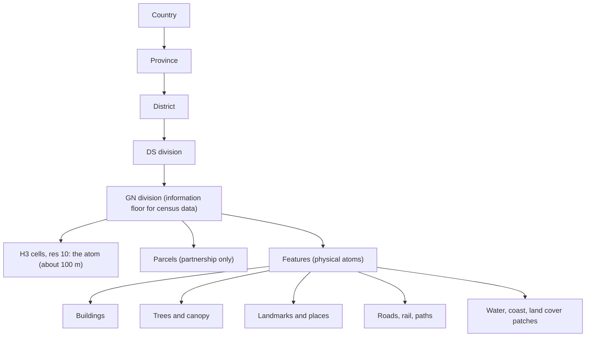

# Multi-scale features: from country to building, land and tree

Status: **proposed** · 2026-11-07 · Decision: D-017 in [decision-log.md](../decisions/decision-log.md) · Builds on [vector-space-model.md](vector-space-model.md) and [spatial-first-analytics.md](spatial-first-analytics.md)

Legend: ✅ verified directly · 🟡 from secondary sources or vendor documentation not checked in detail · ❓ assumption or estimate · ❌ not found.

---

## 1. The idea

The platform should zoom continuously from the whole country down to the smallest things a map can show: individual buildings, land parcels, trees, landmarks, roads, water bodies. Each of these is an **entity** in the vector-native core (D-016), with its own coordinates, attributes and relationships, and each rolls up into the places above it.

I agree with this, with one distinction that matters a lot for trust and privacy: **how fine a layer's cells are is not the same as how fine its information is.**

---

## 2. The atom is a fine cell; every value also carries its information resolution

*Revised 2026-11-07 after the lead pointed to gridded population and land-cover data. An earlier version made the GN "the statistical atom". That framing was too coarse.*

### 2.1 Resolution is not information

Gridded population maps such as WorldPop (100 m) and the Global Human Settlement Layer (GHSL, 100 m and 1 km, shown on LuminoCity3D's world density map 🟡) look far more detailed than GN divisions. They are genuinely useful. But for Sri Lanka, the people data inside them **comes from the GN-level census**, spread within each GN by a model.

Evidence ✅: WorldPop's own input summary spreadsheet (`global-input-population-data-summary.xlsx`, downloaded from WorldPop Hub on 2026-11-07) lists Sri Lanka's input as **"Census of Population and Housing 2012, Population by GN and Sex"**, at administrative level 4 (GN), with **13,938 units**, plus DS-level age tables. The 100 m grid is produced by "Random Forest-based dasymetric redistribution" 🟡 (WorldPop Hub listing): the model spreads each GN's 2012 count across its pixels using covariates such as buildings, night lights and roads.

So a WorldPop pixel tells you **where within a GN people probably live**, which is valuable. It doesn't tell you how many people live there beyond what the 2012 GN total and the model imply. Its *cell* resolution is 100 m; its *information* resolution for population is the 2012 GN. GHSL also describes its population layer as built from "national census data" and satellite data 🟡. I haven't confirmed which Sri Lankan census units it uses ❓.

Other layers really are informative at fine scale, because they are observed per pixel: built-up area, land cover, tree canopy, night lights, elevation. These are still model outputs (classifications of imagery) and carry error, but their information is local.

### 2.2 Three levels

| Level | What it is | Size | Role |
|---|---|---|---|
| **Cell (the common index)** | The finest common analytic unit; refined by [footprint-model.md](footprint-model.md) (D-018): the true atom is the observation with its own footprint, and the cell indexes it. **H3 resolution 10** (about 0.015 km² 🟡, roughly 4 million cells over Sri Lanka ❓), close to the 100 m pixels of WorldPop and GHSL | ~100 m | Every layer can be expressed here: rasters by zonal statistics, features by location, statistics by apportionment |
| **Feature** | Individual mapped objects: buildings, trees, landmarks, roads, water bodies | Object | The physical detail below the cell, or crossing it |
| **Information floor** | For each dataset, the unit its information actually comes from: GN 2024 for the census; GN 2012 for WorldPop's Sri Lanka population; 10 m pixels for WorldCover | Varies | Recorded on every value and **shown to users**; decides what claims are honest |

The GN is no longer "the atom". It's the **information floor for official statistics about people**, which is a property of the data, not of the platform. If DCS ever publishes finer units, or a 2024-based grid with better inputs appears, the floor moves and the design doesn't change.

### 2.3 What this means in practice

- Every dataset records `information_unit` and `information_count` (for example `gn-2012`, 13,938) in its `spatial` block, alongside its cell resolution.
- Every map and value shows an **effective resolution** note, for example: *"Shown at 100 m. Population information comes from 2012 GN totals, distributed by WorldPop's model."*
- Gridded people data is `modelled_estimate`. It's never mixed up with official GN figures, and it never goes below cell level to individual buildings (§6).
- For population specifically, **a 2012-based grid is out of date** against the 2024 Census. Options, in order: (1) use a WorldPop or GHSL release built on 2024 inputs if one exists ❓; (2) rescale an existing grid so each GN matches its 2024 census total, labelled as our own modelled estimate; (3) build our own dasymetric grid from 2024 GN totals and building footprints (G07). Option 2 is cheap and probably good enough for Stage 2.

The zoom ladder:

Approximate H3 cell sizes: resolution 8 ≈ 0.74 km², 9 ≈ 0.1 km², 10 ≈ 0.015 km², 11 ≈ 0.002 km² 🟡 (H3 documentation figures, not checked in detail).

---

## 3. What exists for Sri Lanka

| Feature class | Candidate sources | Licence | What we know |
|---|---|---|---|
| **Buildings** | OpenStreetMap; Overture buildings (merges several sources); Microsoft Global ML Building Footprints; Google Open Buildings v3 | OSM: ODbL. Overture: some themes ODbL where OSM-derived 🟡. Microsoft: ODbL 🟡. Google: check ❓ | Coverage of Sri Lanka **not confirmed** for Microsoft or Google ❓. For scale: the 2024 Census counted 6,030,541 occupied housing units 🟡 ([DCS press release](https://www.statistics.gov.lk/qlink/PressReleases/CPH2024_Press_Release_Eng)), so expect **several million building footprints** ❓ once outbuildings and non-residential buildings are included |
| **Landmarks, places, POIs** | Overture Places; OSM; Wikidata; GeoNames; official facility lists (schools, hospitals) | Overture Places: CDLA-Permissive-2.0 / Apache-2.0, **contains no OSM data** 🟡. Wikidata: CC0. Official lists: check | Good base; quality varies by area ❓ |
| **Roads, rail, paths, water, coast** | OSM | ODbL | Completeness unmeasured ❓ |
| **Gridded population** | WorldPop 100 m; GHSL 100 m / 1 km (as on LuminoCity3D) | WorldPop: CC BY 4.0 ✅ (Hub footer). GHSL: "open and free" 🟡 | WorldPop's Sri Lanka input is **2012 GN census counts** ✅ (§2.1); GHSL's Sri Lanka input not confirmed ❓ |
| **Environmental covariates** | WorldPop's 73 global covariate layers (built-up, night lights, water), ~100 m, 2015 to 2020–2023 🟡 | Not stated on the announcement ❓ | Useful directly as cell-level layers |
| **Land cover** | ESA WorldCover (10 m), others | CC BY 4.0 🟡 | Patches, not objects |
| **Land use / land cover change (regional)** | World Bank–ESA LULC mapping | CC BY 4.0 ✅ (World Bank catalogue) | **Only the Kelani Ganga and Attanagalu Oya catchments**, 1991 / 2001 / 2012, shapefiles ✅. A good historical regional layer, not a national one |
| **Official topographic and thematic layers** | NSDI geoportal and metadata catalogue (catalog.nsdi.gov.lk) | No terms readable ❌ | The geoportal is a JavaScript app; its layers and download terms couldn't be read ❌. Investigate with R01/R02; possibly the richest official fine-scale source ❓ |
| **Geodetic control** | Survey Department control points and SLCORSnet GNSS data | **Paid**: e.g. Rs. 750 per GPS control point, Rs. 2,000 per day of CORS data ✅ (rate schedule) | Improves **positional accuracy** (georeferencing), not resolution. Useful later for field surveys; not a data layer |
| **Trees** | Meta / WRI global canopy height map (1 m) | Free, including commercial use, per reports 🟡; exact licence name not confirmed ❓ | Picks out large trees (canopy over 3 m wide) 🟡; imagery nominally 2018–2020 🟡; a v2 (2026) claims better accuracy 🟡. **It is a canopy surface, not a tree inventory.** Individual trees would be *derived* by crown detection, so `modelled_estimate` |
| **Individual tree inventories** | OSM `natural=tree` points; municipal inventories | — | Sparse in OSM ❓; no municipal inventory found ❌ |
| **Land parcels** | Survey Department cadastre (Bim Saviya title registration), via its online Land Information System | No open terms found ❌ | Between about 0.7 and 1.5 million lots surveyed, depending on the source and year 🟡, against an estimated 12 million parcels nationally (2016 figure) 🟡. The LIS shows **claimant names** 🟡, which is personal data. **Partnership only** |
| **Elevation and terrain** | Copernicus DEM (30 m), SRTM | check 🟡 | Fine for slope, flood exposure |
| **Imagery** | Sentinel-2 (10 m, open); sub-metre commercial imagery | Commercial imagery is restrictively licensed ❓ | **This is the hard limit.** Without sub-metre imagery rights, "every minor detail" depends on what others have already mapped or derived |

**Feature identity:** Overture's Global Entity Reference System (GERS) gives features IDs designed to stay the same across releases 🟡, even when names or footprints change. Use GERS where present. Record OSM, Microsoft and Google IDs in a `FEATURE_CODE` crosswalk, as we do for geography codes. Matching the same building across sources is hard, and Overture already does it, so **reuse its conflation rather than building our own**.

---

## 4. Where I'd push back

**"Every minor detail we can get from a map" is OpenStreetMap's mission, carried out by a global community of volunteers.** A solo founder shouldn't try to become a mapping agency. Sri Lanka Facts adds value by:

1. **Integrating:** bringing the best open feature layers together with stable IDs.
2. **Connecting:** linking every feature to every geography it falls in, to statistics, and to the vector spaces.
3. **Explaining:** turning millions of objects into answers ("how green is this GN?", "how far is the nearest clinic?").
4. **Contributing back:** fixes and Sinhala/Tamil names to OSM, working with the local OSM community.

**Volume isn't value.** Every feature class must pass an **admission test** before ingestion:
- What question does it answer, and for whom?
- Are its rights clear for our use?
- Is its completeness measured, not assumed?
- Who keeps it up to date?

Trees pass for urban greenery and heat questions. Parcels currently fail on rights and privacy. Benches and lamp posts fail until someone needs them.

---

## 5. Features in the vector-native core

Every feature is an entity with coordinates in named spaces (D-016):

| Space | For features | Example dimensions |
|---|---|---|
| `geo` | Location | Unit-sphere position; containing GN, LA, MOH and electorate (exact, from the ledger, not inferred) |
| `form` (new) | Physical form | Footprint area, shape compactness, height where available, roof or land-cover type |
| `context` (new) | Surroundings | Building density within 250 m, canopy cover, distance to road, coast and nearest facilities by type, land-cover mix, satellite embedding at the location |

What this enables:
- **"Buildings like this" / "landmarks like this"**, for example "schools with similar surroundings" or "temples in similar settings".
- **The most valuable near-term use: features give places new profile dimensions.** Building density, footprint size distribution, tree cover, mix of POIs and distance to services become blocks in each GN's `profile` vector. Unlike the census, they can be refreshed yearly, which gives between-census signals at GN level.
- **Context for every value:** a GN page can show what is physically inside it, as well as its statistics.

---

## 6. Hard rules at fine scale

These are non-negotiable, and AGENTS.md gains matching rules.

1. **Statistics about people are never attributed to individual buildings or parcels.** Spreading GN census values onto cells is allowed as a labelled `modelled_estimate`, with its information floor shown (D-014). Spreading them onto individual buildings is **never published**: it would assign household characteristics such as poverty, ethnicity or religion to identifiable homes. Sri Lanka's Personal Data Protection Act core provisions take effect on 1 January 2027 🟡, and the ethical problem stands regardless of the law.
2. **No people at feature level.** No owner, claimant or occupant names, and no personal attributes, even where a public system shows them. Parcels, if ever obtained, are published as geometry and land-use only.
3. **Physical attributes only** on buildings and parcels: shape, size, height, type, materials if mapped, surroundings.
4. **Sensitive sites.** Don't add detail to military, security or critical-infrastructure features beyond what the base map shows. Get legal advice on whether publishing detailed mapping in Sri Lanka needs Survey Department approval ❓. I haven't verified this, and it belongs on the legal checklist.
5. **Licensing stays separate.** Feature layers derived from OSM, and databases built from them, are published under **ODbL** (D-005). The CC BY ledger stays separate. Whether aggregates such as "OSM building count per GN" must also be ODbL needs a short legal check against the OSM Foundation's guidelines ❓. Until then, publish them under ODbL with attribution.

---

## 7. What it does to the architecture

The entity count jumps from about 15,000 places to **millions of features** ❓. Most of the design holds, with three changes:

| Area | Change |
|---|---|
| **Storage** | Features as GeoParquet partitioned by district (or H3 resolution 5), in object storage. Probably low gigabytes for the island ❓. Still files, still releases. |
| **Maps** | Feature PMTiles at zoom 13–16 built with Tippecanoe; buildings, landmarks and canopy as separate layers. The basemap already shows OSM buildings for Stage 1. |
| **Browser** | Never load all features. Load tiles for display, and a per-GN feature file on demand (hundreds to thousands of features per GN ❓). |
| **Pipeline compute** | Country-scale overlays (millions of buildings × GNs × hexes) may exceed standard GitHub Actions runners ❓. Run heavy builds on a local machine or a short-lived larger cloud machine, then publish. Measure in the G08 spike. |
| **Vector search** | Place-level similarity stays static (D-016). **Feature-level similarity over millions of vectors hits D-016's revisit trigger.** It moves to the Stage 3 serving layer (pgvector, or DuckDB `vss` if it is mature by then 🟡). Precomputed feature-to-place roll-ups need no index. |

---

## 8. The experience: zooming in

- **National to GN:** as now, with statistics and spatial context.
- **Inside a GN:** the map shows buildings, landmarks, canopy, land cover and roads. The GN page gains a **"what's here" section**: building count and density, footprint sizes, tree cover, landmarks by type, nearest school, clinic and town, each with its source and licence.
- **A single feature:** a building, tree or landmark shows its physical attributes, every geography it falls in (GN, DS, LA, MOH, electorate), its distances to services, "similar features" (Stage 3), and its sources. **Never people.**
- **Resolver:** any point on the map gives all its geographies at once. This is also the commercial resolver API (OPP-21).

---

## 9. Staging

| Stage | Feature work |
|---|---|
| 1 | None beyond the basemap's OSM buildings shown visually. The flagship stays the Census Atlas. |
| 2 | Buildings (source chosen on measured completeness, G07/G08); landmarks and POIs (Overture Places, OSM, Wikidata); land cover; feature-to-GN roll-ups as a new `profile` block; "what's here" on GN pages; point resolver |
| 3 | Canopy and derived tree crowns (labelled modelled); terrain; road network and travel times; `form` and `context` spaces; feature-level similarity on the serving layer |
| 4 / partners | Parcels (Survey Department, geometry only); official facility registers; municipal tree inventories; sub-metre imagery through a partnership or grant; joint mapping with the OSM Sri Lanka community |

---

## 10. Open questions

- Is there a WorldPop or GHSL population grid built on **2024** Sri Lankan census inputs? Which inputs does GHSL use for Sri Lanka?
- What layers does the NSDI geoportal hold, at what scale, and on what terms?
- Do Microsoft and Google building footprints cover Sri Lanka, and how complete is each against census housing counts? (G08)
- What is the exact licence of the Meta / WRI canopy height map? (R02)
- Does publishing detailed maps need Survey Department approval? (lawyer)
- Under ODbL, are aggregate counts from OSM a derivative database? (short legal check)
- Is the Survey Department open to sharing parcel geometry without personal data? (R04 draft, later)

---

## Sources

- [WorldPop Hub: unconstrained 100 m population counts](https://hub.worldpop.org/geodata/listing?id=29) and its input-data summary spreadsheet (Sri Lanka row)
- [WorldPop: new open-access covariate datasets](https://www.worldpop.org/blog/new-open-access-geospatial-datasets-to-enhance-global-population-mapping/)
- [LuminoCity3D world population density (GHSL 2023)](https://luminocity3d.org/WorldPopDen/)
- [World Bank: Sri Lanka LULC change mapping](https://datacatalog.worldbank.org/search/dataset/0038274/sri-lanka-land-use-land-cover-lulc-change-mapping)
- [Survey Department geodetic services and rates](https://survey.gov.lk/sdweb/pages_service_geodetic_survey.php?id=5ccb8836989a061a86dc4c9d10728a15802b3f88)
- [NSDI geoportal](https://geoportal.nsdi.gov.lk)

- [DCS Census 2024 press release](https://www.statistics.gov.lk/qlink/PressReleases/CPH2024_Press_Release_Eng) (6,030,541 occupied housing units)
- [Overture Maps FAQ](https://overturemaps.org/about/faq/) (licensing, GERS)
- [Land Carbon Lab: mapping the world's trees](https://landcarbonlab.org/insights/mapping-trees-unprecedented-detail-ai/)
- [Mongabay on the canopy height map](https://news.mongabay.com/2024/04/ai-model-maps-global-tree-canopy-heights-in-hi-res-with-carbon-counting-in-mind/)
- [WILDLABS review of the canopy height map](https://wildlabs.net/node/11935)
- [Microsoft building footprints (OSM wiki)](https://wiki.openstreetmap.org/wiki/Microsoft_Building_Footprints)
- [Bing Maps global building footprints announcement](https://blogs.bing.com/maps/2023-06/Bing-Maps-Global-Building-Footprints-released)
- [Survey Department online LIS (Daily FT)](https://www.ft.lk/business/arcgis-powers-survey-departments-online-land-information-system/34-409567)
- [Bim Saviya progress (Daily Mirror)](https://dailymirror.lk/amp/breaking-news/Bim-Saviya-completed-in-700-000-lots-so-far-Surveys-Dept/108-183055)
- [Sri Lanka UN-GGIM presentation, 2016](https://ggim.un.org/meetings/2016-4th_HLF/documents/5-Palitha%20Presentation%20Sri%20Lanka-21-April%202016.pdf)
