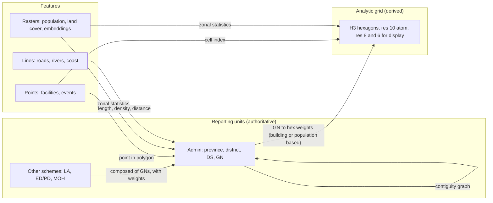

# Spatial-first analytics

Status: **proposed** · 2026-11-07 · Decisions: D-013, D-014, D-015 in [decision-log.md](../decisions/decision-log.md) · Related: [data-model.md](data-model.md), [architecture-overview.md](architecture-overview.md)

> **Superseded in part by [vector-space-model.md](vector-space-model.md) (D-016).** Place vectors (§6) are now one space within a vector-native core in which every entity has coordinates and relationships are distances. The spatial contract, fabrics and spatial context here still apply.

Legend: ✅ verified directly · 🟡 from secondary sources or vendor documentation not checked in detail · ❓ assumption or estimate.

---

## 1. The idea in one paragraph

Most data portals treat location as a **filter**: pick a district, see a table. Sri Lanka Facts should treat location as **the structure of the data and the first question of every analysis**. Every value has a *where*. Every value is shown against *compared to where*: its neighbours, its parent, places like it and the country. Every place also has a *profile vector*, all its numbers taken together, so you can ask "which places are like this one?", "what kind of place is this?" and "which way is it changing?". A user can also *draw* the geography they care about (a radius, a coastal strip, a catchment) and get the numbers for it, with an honest label saying how exact they are.

None of the techniques is new on its own: geodemographic classification, local spatial statistics, hexagonal grids, satellite embeddings. What is new is putting them together, by default, for a general audience, on a provenance-tracked national spine down to GN level. Nobody does that for Sri Lanka, and few platforms do it anywhere ❓.

**Two meanings of "vector", both used here:**
1. **Vector geometry:** points, lines and polygons (GN boundaries, facilities, roads). This is the spatial fabric.
2. **Vectors as embeddings:** a list of numbers that describes a place, so places can be compared, clustered and searched by similarity. This is the analytic engine.

The design uses both. If you meant only one, tell me and I'll trim the other.

---

## 2. Where I agree, and where I'd push back

| Your direction | My view | Recommendation |
|---|---|---|
| All data should have geographical metadata | Yes, and it should be **honest** metadata. Many numbers are national only (GDP, the policy rate). Some are measured in one place and used for the country: the Colombo Consumer Price Index is collected in Colombo district 🟡. Forcing these onto sub-national units would invent precision. | Every dataset declares its **spatial support**, and "national" is a valid answer. Record where a number was *measured* separately from what it *represents* (§3). |
| Model it spatial first | Yes, as a **contract and a set of operations**, not by putting geometry on every row. Geometry is stored once per place version. Observations point to places by ID. That keeps the data small, reviewable and static-first (D-003). | Spatial-first = every dataset has spatial support, every place has neighbours and composition, and every analysis is a spatial operation. Not "everything in PostGIS". |
| Spatiality as a core function of analytics | Yes. It's also the strongest differentiator: nuuuwan publishes the census as tables; nobody publishes it with spatial context. | Spatial context is the **default view** for every indicator, not an advanced tool (§5). |
| Exploration with vectors | Strong idea, with one risk: similarity looks objective but depends on which indicators go in and how they're weighted. | Always show *why* two places are similar. Let users change the ingredients. Leave ethnicity and religion out of the default profile (§6.4). |
| A new way of doing analytics | Achievable, but it can swallow the flagship. | Stage it. Spatial context and "places like this" go into the Census Atlas, since they are cheap and precomputed. Drawing your own area, the typology and satellite vectors come later (§9). |

Two cautions run through everything below:

- **The modifiable areal unit problem (MAUP).** Patterns change with the units you aggregate to: a hotspot at GN level can vanish at DS level. The platform should *show* this rather than hide it (§5.3).
- **The ecological fallacy.** Place data describes places, not people. "GNs with more X also have more Y" does not mean people with X have Y. Explanations must say so.

---

## 3. The spatial contract (every dataset)

Every catalogue dataset gets a `spatial` block. The pipeline refuses a dataset without one.

```yaml
# in catalog/datasets/<id>.yaml
spatial:
  support: area            # area | point | line | grid | national
  scheme: admin            # for area: admin | la | electoral | health | ...
  level: gn                # lowest level published by the source
  vintage: "2024"          # boundary vintage the source used
  coverage: LK             # geography_id(s) covered; partial coverage listed explicitly
  measured_in: null        # where the data was actually collected, if narrower than coverage (e.g. LK11, Colombo district, for the CCPI)
  positional_accuracy: null  # for point/line: metres or "address-level" / "village-centroid"
  crs_source: EPSG:5235    # as published by the source; always confirmed, never assumed
  resolution: null         # for grid: cell size, e.g. "100 m" or "h3:10"
  information_unit: gn-2024   # the unit the information really comes from (e.g. gn-2012 for WorldPop Sri Lanka)
  information_count: null  # number of such units, e.g. 13938
  derived_by: null         # if moved from another support: method id (see §4.3)
```

| Support | Examples | How it joins the spine |
|---|---|---|
| `area` | Census tables by GN; dengue by MOH; results by polling division | `geography_id` through the crosswalk (D-004) |
| `point` | Schools, hospitals, bank branches, disaster events, weather stations | Point-in-polygon resolver assigns IDs at every scheme and level; geometry is kept |
| `line` | Roads, rail, rivers, coastline | Used for distances, access and buffers; summarised to areas as length or density |
| `grid` | WorldPop 100 m population, night lights, land cover, satellite embeddings | Zonal statistics to GN (and H3), with the method recorded |
| `national` | GDP, exchange rate, policy rate | Attached to `LK`; never pushed down to sub-national units |

An observation's quality label already records `data_nature` (D-009). Any value created by moving data from one support to another, for example census counts spread onto a grid, is at best `modelled_estimate`, whatever the source's own label was.

---

## 4. Three spatial fabrics and the bridges between them



### 4.1 Reporting units: authoritative

*Features (buildings, trees, landmarks) below GN level are covered in [multi-scale-features.md](multi-scale-features.md) (D-017).*

Admin units and the other schemes, as already designed, with **GN divisions as atoms** (data-model §3.4). This is how data is published and cited. Released values are always on reporting units unless clearly labelled otherwise.

New piece: a **contiguity graph** per vintage, recording which GNs (and DSs, districts) share a border, plus distance-band neighbours for islands and coastal units. Everything in §5 is built on it. It's small: about 14,000 nodes ❓.

### 4.2 Analytic grid: derived, never the source of truth

**H3 hexagons** ([H3](https://h3geo.org), Apache-2.0) give a common fabric that doesn't depend on any boundary vintage. They're useful for rasters, points, drawn areas and comparisons across boundary changes.

- **Resolution 10** (about 0.015 km² per cell 🟡, roughly 4 million cells over Sri Lanka ❓) is **the atom**: the finest common unit, matched to 100 m population and covariate grids. See [multi-scale-features.md §2](multi-scale-features.md#2-the-atom-is-a-fine-cell-every-value-also-carries-its-information-resolution).
- **Resolution 8** (about 0.74 km² per cell 🟡, roughly 89,000 cells ❓) for most analysis and mid-zoom display.
- **Resolution 6** (about 36 km² 🟡) for national-scale display.
- Census values are spread onto hexes only through GN-to-hex weights based on buildings or modelled population. These are `modelled_estimate`, shown with a label, never as the default map of a census indicator.

Why H3 and not a square grid: neighbour relations are uniform, the hierarchy is built in, and the tooling is mature in Python, the browser (`h3-js`) and DuckDB (the `h3` community extension, Apache-2.0 🟡. DuckDB doesn't vet community extensions 🟡, so pin the version). Squares (for example the 1 km grids common in Europe) would also work. The choice is reversible because the grid is derived.

### 4.3 Bridges are named, versioned operations

Data moves between fabrics only through a small set of named methods, each recorded in `derived_by` and in provenance:

| Method id | From → to | Notes |
|---|---|---|
| `aggregate_sum` | GN → any composed unit | Exact for counts when the unit is made of whole GNs |
| `aggregate_recompute` | GN → any unit | Rates recomputed from numerator and denominator |
| `apportion_weighted` | GN → hex or partial GN | `modelled_estimate`; the weight source is named (buildings, WorldPop) |
| `point_in_polygon` | point → every scheme | Records the boundary vintage; points on borders flagged |
| `zonal_stats` | raster → GN, hex | Statistic (mean, sum, share) and the raster's own licence recorded |
| `network_distance` | points + roads → GN, hex | Travel distance or time to the nearest facility; the routing engine and OSM date recorded |

This is what keeps "spatial-first" honest: every move is visible, reversible and labelled.

---

## 5. Spatial context by default: "compared to where?"

Every indicator value, on every place page and on the map, answers four comparisons automatically:

| Comparison | Example on the page for a GN (illustrative numbers) | How |
|---|---|---|
| **Neighbours** | "18.2%, higher than all 6 bordering GNs (median 9.4%)" | Contiguity graph; the spatial lag |
| **Parent** | "DS average 11.0%, district 10.1%" | Hierarchy |
| **Similar places** | "Places with a similar profile average 17.5%" | Place vectors (§6) |
| **Country** | "National 12.3%, rank 1,204 of 14,0xx" | Simple |

### 5.1 Clusters and outliers

For each indicator and level, the pipeline computes **local spatial statistics** (local Moran's I, with [PySAL](https://pysal.org), BSD-3 🟡):

- **Clusters:** high values surrounded by high values ("hot"), low surrounded by low ("cold").
- **Spatial outliers:** a high value surrounded by low values, or the reverse. These are often the most interesting places, and often the ones with data errors. Outliers feed the QA report as well as the map.
- **Multiple testing:** thousands of places × hundreds of indicators will produce false clusters by chance. Use permutation tests with false-discovery-rate control, and only call something a cluster when it survives.

### 5.2 Small numbers

Many GNs have only a few hundred households, so rates jump around. Show the **raw rate**, offer a **smoothed rate** (empirical Bayes, shrinking towards the parent or neighbours) labelled `modelled_estimate`, and grey out values whose denominators fall below a stated threshold. This builds on data-model §9 (small numbers and privacy).

### 5.3 Scale check (MAUP made visible)

For any pattern, show it at GN, DS and district side by side, and flag when the story changes: for example "clustered at GN level, not at DS level". This is a small feature that teaches users something real, and as far as I know it's rare in public data portals ❓.

---

## 6. Place vectors: exploring by similarity

### 6.1 What a place vector is

For each place, level and vintage, a **profile vector** made of standardised indicators grouped into blocks:

| Block | Example ingredients (Census 2024 first) | Available |
|---|---|---|
| Demography | Age structure, dependency ratio, household size, sex ratio | Stage 1 |
| Housing and amenities | Floor and roof materials, water source, toilet, lighting, cooking fuel | Stage 1 |
| Education and work | Attainment, literacy, labour-force participation, sector of employment (where tabulated) | Stage 1 (subject to table availability ❓) |
| Access | Distance to the nearest hospital, school, bank, town | Stage 3 |
| Landscape | Built-up share, land cover, satellite-embedding summary | Stage 3 |
| Change | 2012→2024 differences (DS level, through the boundary crosswalk) | Stage 2 |

Each indicator is transformed (shares as-is or log-ratio, counts per capita), standardised, and each **block weighted equally by default**, so the block with the most columns doesn't dominate.

### 6.2 What you can do with it

1. **Places like this:** the 10–20 most similar places anywhere in the country, with *why*: the blocks and indicators that matched most and least. Example question: "Which GNs outside Colombo look most like this Colombo GN?"
2. **Typology:** cluster all GNs into 8–15 named types, for example "older rural paddy villages" or "dense urban rental". This is a **Sri Lankan geodemographic classification**, comparable in spirit to the UK Output Area Classification 🟡. It's a strong public good and a commercial asset for sampling and market work.
3. **Odd ones out:** places unlike their neighbours *and* unlike their type. These are research leads and QA leads.
4. **Change vectors:** where a place moved in profile space between 2012 and 2024, and which type it now resembles. "This DS looks more like a suburban DS than it did in 2012."
5. **Custom recipes:** users choose blocks or indicators and weights in the browser, and similarity is recomputed live.

### 6.3 Why no vector database

About 14,000 GNs × about 100 dimensions is roughly 1.4 million numbers ❓, a few megabytes. Brute-force similarity over that takes milliseconds in a browser. So:

- The pipeline precomputes default vectors, the top-20 neighbours per place and the typology, and publishes them as release files.
- The browser recomputes custom recipes with plain typed arrays or DuckDB-WASM.
- **No vector database, no embedding service, no server.** This stays inside D-003. Revisit only if vectors grow by orders of magnitude, for example per-hexagon satellite embeddings, and even then precomputing is likely enough.

### 6.4 Guardrails

- **Explainability is mandatory.** Never show "similar" without the reasons.
- **Ethnicity and religion are left out of the default profile.** Similarity and clusters built on them could be misused to label places in a country with a recent history of communal conflict. Those indicators stay available as ordinary indicators with neutral presentation. Whether to allow them in custom recipes is your decision (D-015).
- **Typology names are descriptive, not judgemental**, reviewed by a person, and published with their method. Types are revised only by a new release, never quietly.
- **Similarity isn't ranking.** No "best places" lists built from vectors.

### 6.5 Satellite embeddings: an experiment, not a dependency

Google and DeepMind's **AlphaEarth Foundations Satellite Embedding** dataset gives every 10 m pixel a 64-dimensional annual embedding ✅ (Earth Engine catalogue). Google's documentation states a CC BY 4.0 licence 🟡, but one secondary source says Apache-2.0, so check before use. The year range also differs by source: 2017–2024 or 2017–2025 🟡. Copies exist on Google Cloud (requester pays) and on the AWS Open Data registry 🟡.

Averaged per GN or hex, these could give a **landscape block** that changes yearly, a between-census signal (OPP-18). Treat it as a Stage 3 experiment:

- Check the licence, attribution and the terms of whichever platform you process it on (Earth Engine's commercial terms differ from its non-commercial ones 🟡).
- Validate it: do embedding changes track known 2012→2024 census changes?
- Embeddings aren't interpretable on their own. Show them only as "landscape similarity", never as a measured indicator.

---

## 7. Ask with geometry: user-defined areas

Geography becomes a **query parameter**, not a fixed menu.

| Input | Example | Stage |
|---|---|---|
| Pick existing units | "These 12 GNs" | 2 |
| Radius around a point | "Within 5 km of this clinic" | 2 |
| Drawn polygon | A proposed service area | 2 |
| Buffer around a line | "Within 1 km of the coast", "along the A9" | 3 |
| Travel time | "Within 30 minutes by road of this hospital" | 3 |

**How it works without a server:** the browser intersects the shape with GN polygons (or H3 cells), uses whole GNs exactly and apportions partial GNs by building or population weights, and sums components from the release files. The result is labelled, for example: *"Approximate: 41 whole GNs, 7 partial GNs apportioned by building footprints. Census 2024, release v2027.MM.1."*

This is also the core of the paid catchment and sampling-frame work (OPP-05, OPP-06). The public version proves the method; commissioned work adds custom inputs and a written report.

---

## 8. Natural-language questions, answered spatially

An AI layer (Stage 2+, after the MCP server, A01) turns a question into a **visible spatial query plan**, then runs it deterministically:

> *"Which DS divisions within 20 km of the coast have an older population than their district average?"*
> Plan: geography = DS divisions intersecting a 20 km coastal buffer · indicator = population share aged 60+ · comparison = parent district · data = Census 2024, release v2027.MM.1.

The model writes the plan; the platform computes the numbers. The language model never produces a figure itself (D-011). The user sees and can edit the plan, and every number links to its source.

---

## 9. What this changes in the plan

| Stage | Additions | Why then |
|---|---|---|
| **0** | Spatial contract in the catalogue schema (F02); contiguity graph built with the spine (G01); CRS checks | Cheap now, expensive to add later |
| **1: Census Atlas** | Neighbour and parent comparison on every value; clusters and outliers for core indicators; small-number handling; "places like this" (precomputed); outliers in QA | Precomputed, static, makes the flagship clearly more than tables |
| **2** | GN-to-hex weights; drawn and radius areas; typology v1; change vectors 2012→2024; scale check; DuckDB-WASM custom recipes | Needs building or population weights and the boundary crosswalk |
| **3** | Points and access (facilities, OSM roads, travel time); landscape block; satellite-embedding experiment; natural-language spatial queries | Needs facility data, rights checks and the MCP layer |

New release artefacts (all static files):

```
releases/vYYYY.MM.N/
  spatial/adjacency_{level}_{vintage}.parquet     contiguity graph
  spatial/gn_h3r10_weights_{vintage}.parquet      Stage 2 (res 8 and 6 derived from it)
  stats/local_{indicator}_{level}.parquet         cluster/outlier class, p-value, smoothed rate
  vectors/profile_{level}_{vintage}.parquet       standardised profile vectors + recipe
  vectors/similar_{level}_{vintage}.json          top-20 similar places with reasons
  vectors/typology_{vintage}.parquet              Stage 2
```

A new pipeline stage, **enrich**, sits between validate and publish. It reads only validated observations, so every derived file inherits full provenance.

Tools added (all open source, all run in the existing pipeline): `h3` (Python and JS), PySAL (`libpysal`, `esda`), scikit-learn for clustering. No new services.

---

## 10. Spatial inputs worth knowing

| Input | What | Licence | Status |
|---|---|---|---|
| COD-AB Sri Lanka (HDX) | Admin boundaries to GN | as listed on HDX | ✅ exists; licence per landscape doc |
| WorldPop Sri Lanka 100 m | Modelled population grid | CC BY 4.0 🟡 | 🟡 [hub.worldpop.org](https://hub.worldpop.org/doi/10.5258/SOTON/WP00251) |
| Kontur Population, Sri Lanka | Population on H3 (about 400 m) | not confirmed ❓ | 🟡 catalogued by [BTAA](https://geodev.btaa.org/catalog/c99cdd72-1cb7-4411-b866-176903ab721e) |
| Google Open Buildings v3 | Building footprints, "South Asia" | check ❓ | ❓ Sri Lanka coverage not confirmed |
| Overture / OSM buildings and roads | Footprints, road network | ODbL (OSM) | ❓ completeness in Sri Lanka unmeasured |
| AlphaEarth satellite embeddings | 64-dim annual embedding per 10 m pixel | CC BY 4.0 per Google 🟡 | ✅ dataset exists ([Earth Engine](https://developers.google.com/earth-engine/datasets/catalog/GOOGLE_SATELLITE_EMBEDDING_V1_ANNUAL)) |

A Stage 2 task (G07) should pick the weighting source by measuring building completeness against census household counts per GN, not by assuming.

---

## 11. Risks

| Risk | Mitigation |
|---|---|
| Spatial features delay the flagship | Stage 1 gets only precomputed context and similarity; everything interactive waits for Stage 2 |
| Modelled values mistaken for official ones | `data_nature` label everywhere; modelled layers never the default map |
| False hotspots | Permutation tests with FDR control; no cluster language without significance |
| Similarity or typology used to stigmatise places | No ethnicity or religion in defaults; descriptive names; reasons shown; no rankings |
| Over-claiming novelty | Describe it as "an integrated, provenance-first spatial view", not a new science |
| Agents produce plausible but wrong spatial statistics | Prompt D06 requires known-answer tests (synthetic grids with planted clusters) and a QGIS review pack |

---

## Sources

- [H3 hexagonal index](https://h3geo.org)
- [DuckDB community extensions](https://duckdb.org/2024/07/05/community-extensions) (note on vetting)
- [AlphaEarth Foundations paper](https://arxiv.org/abs/2507.22291)
- [Satellite Embedding V1 Annual, Earth Engine catalogue](https://developers.google.com/earth-engine/datasets/catalog/GOOGLE_SATELLITE_EMBEDDING_V1_ANNUAL)
- [AlphaEarth on AWS Open Data](https://registry.opendata.aws/aef-source/)
- [WorldPop Sri Lanka 100 m](https://hub.worldpop.org/doi/10.5258/SOTON/WP00251)
- [Kontur 400 m H3, Sri Lanka (BTAA catalogue)](https://geodev.btaa.org/catalog/c99cdd72-1cb7-4411-b866-176903ab721e)
- [PySAL](https://pysal.org)
