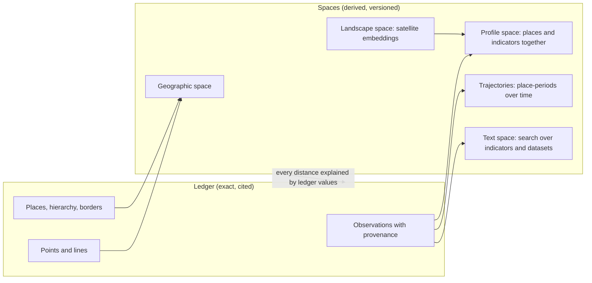

# Vector-space model: the conceptual core

Status: **proposed** · 2026-11-07 · Decision: D-016 in [decision-log.md](../decisions/decision-log.md) · Builds on [spatial-first-analytics.md](spatial-first-analytics.md) · Related: [data-model.md](data-model.md)

Legend: ✅ verified directly · 🟡 from secondary sources or vendor documentation not checked in detail · ❓ assumption or estimate.

---

## 1. The idea

Every entity in Sri Lanka Facts (a GN division, a district, a building, a tree, a hospital, an indicator, a year) is a **point in a multi-dimensional space**. How two entities relate is read off their **distance** in that space: the closer they are, the more alike they are in the respects the space measures. Exploring data then means **moving through the space**: "what is near this place?", "what lies between these two?", "which direction did this place move between 2012 and 2024?", "which indicators point the same way?".

This is a stronger form of the spatial-first idea, not a replacement for it. **Geography is one set of dimensions**: a place's coordinates are a vector too, and physical distance is the distance in that subspace. Demography, housing, landscape, access and time are further sets of dimensions. Spatial-first analytics becomes a special case: the space with the geographic dimensions weighted heavily.

**One precise point:** the relationship between two entities is the **distance between them**, that is, the length of the vector that joins them (‖a − b‖), or the angle between them (cosine). The length of a single vector on its own (‖a‖) measures something different: how far an entity is from the average, or how extreme it is. Both are useful. The design uses distance for relationships and length for "how unusual is this place?".

---

## 2. My view: build it, but keep facts and vectors apart

I think this is a strong, distinctive concept for the product. I also think one version of it would quietly undermine the project. The difference is **what counts as the truth**.

| Approach | What it means | My view |
|---|---|---|
| **Vector-only core** | Entities exist as embeddings; relationships, including hierarchy and adjacency, are inferred from distances | ❌ Reject. "Ampara is 0.93 likely to be in the Eastern Province" is wrong: membership is a fact, not a similarity. Embeddings can't be cited, change every time they are recomputed, and can't be audited cell by cell. Trust is the product. |
| **Vector-native, fact-anchored core** | Exact facts (values, sources, hierarchy, borders) live in the **ledger**. Every entity also has coordinates in **named, versioned spaces** computed deterministically from the ledger. All exploration and relationship-finding happens in the spaces; every result links back to ledger facts. | ✅ Recommend. Delivers the concept fully, keeps provenance, stays static and cheap. |

So the architecture has two layers:

The rule that keeps it honest: **a distance is never presented as a fact.** It's presented as "close in *this* space, *because of* these ledger values".

---

## 3. Why one undifferentiated space doesn't work

Your sentence "every entity's relationship to another would be calculated by its vector length in the multi-dimensional space" is right in spirit. Taken literally, with one space for everything, it runs into four problems:

1. **Different relationships aren't one quantity.** "Inside", "borders", "similar to", "flows to", "measured by" are different kinds of relation. Collapsing them into one number loses meaning. Keep exact relations in the ledger and use distance for *degree* relations (alike, near, changed).
2. **Distances between unlike entities need a shared model.** The distance between a hospital and an indicator means nothing unless both were placed in the same space by a method designed for it. The design builds joint spaces only where a principled method exists (§5).
3. **High dimensions blur distance.** With many dimensions, every point tends to be about equally far from every other, so "nearest" stops meaning much. This is a well-known result in nearest-neighbour research. Spaces need few, well-chosen dimensions, obtained by reducing many indicators to a few meaningful axes.
4. **The metric is a choice.** Which dimensions count, and how much, decides who is "near" whom. That choice must be visible and adjustable, never hidden.

The answer to all four is the same: **several named spaces, each with a stated recipe and metric, combinable by the user.**

---

## 4. Spaces

Each space has an id, a version, a recipe (inputs, transformations, weights), a metric and the entity types it contains.

| Space | Entities | Dimensions | Metric | Stage |
|---|---|---|---|---|
| `geo` | Places, points | Position on the globe (3D unit vector from lat/lon) plus, optionally, a graph embedding of the border network | Great-circle distance; graph hops | 1 |
| `profile` | Places **and indicators**, jointly (§5) | 10–30 latent axes from census indicators | Euclidean on standardised axes | 1 |
| `landscape` | Places, hexes | AlphaEarth 64-dim annual embeddings, averaged | Cosine | 3 (experiment, licence check) |
| `access` | Places, hexes | Travel time to facility types | Euclidean on log minutes | 3 |
| `trajectory` | Place-periods (place × census year) | `profile` axes, fixed across years | Euclidean; displacement vectors | 2 |
| `text` | Indicators, datasets, sources, explainers | Text embeddings of names and definitions | Cosine | 2 |
| `form` | Features (buildings, landmarks, trees) | Footprint area, compactness, height, type | Euclidean on standardised | 3 ([multi-scale-features.md](multi-scale-features.md)) |
| `context` | Features | Surroundings: density, canopy, distances to road, coast and facilities, land-cover mix | Euclidean on standardised | 3 |
| `composite` | Places | Weighted combination of the above, chosen by the user | Weighted sum of per-space distances | 2 |

`composite` is where your concept becomes a user experience: sliders for *where*, *who lives here*, *what the land looks like* and *how far from services*, and the space reshapes as you move them.

---

## 5. The first joint space: places and indicators together

The most valuable and most defensible space puts **places and indicators in the same coordinates**, so you can measure place-to-place, indicator-to-indicator and place-to-indicator relations in one space.

**Method:** take the matrix of places × indicators (for example about 14,000 GNs × about 100 standardised census indicators ❓), and factorise it with principal component analysis (or correspondence analysis for count tables). This gives:

- **Place coordinates:** two GNs are close when their whole census profile is alike.
- **Indicator coordinates:** two indicators are close when they rise and fall together across places, for example "cooking with firewood" near "no piped water".
- **Place–indicator relation:** a place lies in the direction of the indicators where it scores high. This is the classic biplot.

Why this method first:

- **Deterministic and reproducible:** same release, same coordinates. No model training, no randomness, nothing to retrain.
- **Interpretable:** each axis is a weighted mix of named indicators, so it can be labelled, for example "axis 1: urban amenities ↔ rural traditional housing".
- **Exactly explainable:** the squared Euclidean distance between two places is the **sum of the contributions from each axis**, and each axis traces back to indicators. "These two GNs are far apart mainly because of housing materials (54%) and age structure (21%)" is an exact statement, not an approximation.
- **Cheap:** a few megabytes; computed in seconds in the pipeline.

Learned embeddings (neural models, satellite foundation models) come later as additional spaces, labelled as such, never as replacements for this one.

---

## 6. What you can ask

| Question | Operation in vector terms |
|---|---|
| Which places are like this one? | Nearest neighbours in `profile` (or `composite`) |
| How different are these two places, and why? | Distance, decomposed into axis and indicator contributions |
| How unusual is this place? | Its vector length from the national centre (‖a − centre‖), compared with the distribution |
| Which places are like this one but far away? | Near in `profile`, far in `geo` |
| Which neighbours are unlike each other? | Near in `geo`, far in `profile`: sharp local contrasts, and often data errors |
| Which indicators move together? | Nearest indicators in `profile` |
| What characterises this district? | Indicators the district's vector points towards |
| How did this place change? | Displacement vector in `trajectory` from 2012 to 2024; its length is the amount of change and its direction says what changed |
| Which places changed the same way? | Similar displacement vectors |
| Which places sit between A and B? | Points near the line from A to B in `profile` |
| What kinds of places are there? | Clusters in `profile` → the typology |
| Find data about "water access" | Nearest neighbours in `text` |

The two-space questions ("near here, unlike here" and "far away, like here") are where the vector core and spatial-first meet. I think they're the most distinctive questions the product can answer.

---

## 7. Experience: two maps side by side

The explorer shows **the geographic map and the similarity map together**:

- Left: the familiar map of Sri Lanka.
- Right: the same places laid out by profile, where similar places sit together.
- Selecting or brushing on one highlights the same places on the other. Selecting a cluster in the similarity map lights up where those places are in the country; selecting a region on the geographic map shows whether it is uniform or mixed.

Two cautions:
- 2D layouts distort. PCA keeps global distances faithfully but crams detail; UMAP and t-SNE show local clusters well but distort distances between clusters. Default to PCA, offer UMAP clearly labelled "layout for clusters, not distances", and always compute real distances in the full space, not on the picture.
- The similarity map must work without WebGL and be explainable in text, for accessibility and low-end phones (D-002).

---

## 8. Data model additions

| Entity | Lives in | Purpose |
|---|---|---|
| VECTOR_SPACE | `catalog/spaces/{space_id}.yaml` | Id, version, recipe (inputs, transformations, weights), metric, entity types, method notes |
| EMBEDDING | `vectors/{space_id}_{version}.parquet` in each release | `entity_type`, `entity_id`, `period`, `space_id`, `space_version`, `vector` (fixed-length float32 array), `norm` |
| AXIS | `vectors/{space_id}_{version}_axes.parquet` | For interpretable spaces: axis loadings on indicators, variance explained, human label (approved by the lead) |

Rules:
- A space version is tied to a release. Coordinates from different space versions are never compared.
- Recipes exclude ethnicity and religion by default (D-015).
- Every published relationship (a "similar places" list, a cluster, a distance) records `space_id` and `space_version`.

Size check: GN profile space about 14,000 × 30 floats ≈ 1.7 MB ❓; landscape on H3 resolution 8, about 89,000 × 64 floats ≈ 23 MB ❓. Static files are enough.

---

## 9. Technology

- **Pipeline:** NumPy and scikit-learn (PCA, clustering), `prince` or similar for correspondence analysis if needed ❓, UMAP for layouts. All deterministic with fixed seeds where randomness exists.
- **Browser:** typed arrays for brute-force distance over tens of thousands of points (milliseconds); DuckDB-WASM for joins with ledger data.
- **When indexes are needed:** DuckDB's `vss` extension offers HNSW indexes with Euclidean, cosine and inner-product metrics 🟡, but it is labelled experimental and its index must fit in memory 🟡. `pgvector` would be the choice if the Stage 3 Postgres serving layer arrives. **No dedicated vector database.** Revisit only at millions of vectors, for example per-pixel embeddings, which we don't need to publish.

---

## 10. Risks

| Risk | Mitigation |
|---|---|
| Distances taken as facts | Ledger/space separation; every distance comes with its space, version and explanation |
| Hidden value choices in recipes | Recipes public, versioned, adjustable; ethnicity and religion out of defaults |
| Spaces change between releases and confuse users | Space versions tied to releases; changelog explains axis changes |
| Concept too abstract for general users | Lead with plain questions ("places like mine", "what makes this place different"), not with "vector space"; user-test in the Stage 1 soft launch |
| Over-engineering | Stage 1 builds only `geo` and `profile`; everything else waits for evidence of use |

---

## 11. Staging

| Stage | Vector work |
|---|---|
| 0 | `VECTOR_SPACE` and `EMBEDDING` schemas in the catalogue (F02); `geo` coordinates built with the spine |
| 1 | `profile` joint space for GN and DS (A03); similar places with exact explanations; "how unusual" scores; near-here-unlike-here contrasts |
| 2 | `trajectory` 2012→2024 (DS level); `text` space for search; `composite` with sliders; two-map explorer (W08); typology |
| 3 | `landscape` and `access` spaces; learned embeddings as experiments |

---

## Sources

- [DuckDB vector similarity search (vss)](https://duckdb.org/2024/05/03/vector-similarity-search-vss) and [docs](https://duckdb.org/docs/current/core_extensions/vss)
- [AlphaEarth Foundations paper](https://arxiv.org/abs/2507.22291)
- Background (standard methods, no specific claim relied on): principal component analysis and biplots; correspondence analysis; Beyer et al., "When is nearest neighbor meaningful?" (1999), on distance concentration in high dimensions.
