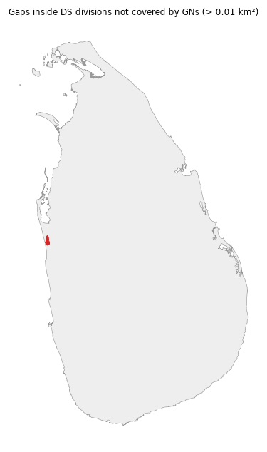
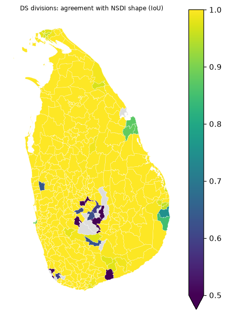

# Geometry QA: COD-AB v03 (canonical, unsimplified)

Generated by `slf geometry-qa build` (`pipeline/slf/datasets/geometry_qa.py`, prompt G03). Areas in EPSG:5235. Findings only; no geometry was edited.

## 1. Structure

| level | units | invalid | empty | multipart_units | max_parts | units_with_holes | total_holes |
|---|---|---|---|---|---|---|---|
| 0 | 1 | 0 | 0 | 1 | 391 | 1 | 4 |
| 1 | 9 | 0 | 0 | 6 | 345 | 3 | 5 |
| 2 | 25 | 0 | 0 | 9 | 175 | 3 | 5 |
| 3 | 339 | 0 | 0 | 44 | 98 | 12 | 13 |
| 4 | 14043 | 0 | 0 | 245 | 50 | 29 | 29 |

Invalid geometries: 0. No `make_valid` copy needed; tiles and analysis should use the canonical geometry as is.

## 2. Overlaps between units of the same level

| level | overlaps > 0.01 km² | of which siblings | total km² | largest km² |
|---|---|---|---|---|
| province | 0 | 0 | 0.000 | 0.000 |
| district | 0 | 0 | 0.000 | 0.000 |
| ds | 0 | 0 | 0.000 | 0.000 |
| gn | 0 | 0 | 0.000 | 0.000 |

Top 10 GN overlaps:

None.

## 3. Gaps and coverage

Area of each parent not covered by its children:

| level (children) | gaps > 0.01 km² | slivers | total km² | largest km² |
|---|---|---|---|---|
| province | 0 | 0 | 0.000 | 0.000 |
| district | 0 | 0 | 0.000 | 0.000 |
| ds | 1 | 0 | 31.171 | 31.171 |
| gn | 1 | 0 | 26.061 | 26.061 |

Top 10 gaps inside a DS division (GN level):

| parent_id | gap_km2 | thinness | sliver | parent |
|---|---|---|---|---|
| LK6218 | 26.0613 | 0.3263 | False | Mundel |

Coverage of the country polygon by each level:

| level | level_name | union_km2 | country_km2 | missing_km2 | missing_pct |
|---|---|---|---|---|---|
| 1 | province | 66034.09 | 66034.09 | 0.00 | 0.00 |
| 2 | district | 66034.09 | 66034.09 | 0.00 | 0.00 |
| 3 | ds | 66002.92 | 66034.09 | 31.17 | 0.05 |
| 4 | gn | 65976.86 | 66034.09 | 57.23 | 0.09 |

## 4. Comparison with NSDI shapes

NSDI snapshot `raw/nsdi/nsdi-admin-boundaries/20261107T170643Z/nsdi_district_ds_geometry.json` (sha256 `aeb816f5b25f8719…`), matched through `catalog/geographies/codes/nsdi.csv`. IoU = intersection over union (1 = identical). NSDI `adjusted_area` is shown as published; its definition and unit are unknown.

### Districts: 25 compared; median IoU 1.0000, 10th percentile 0.9970; 0 below 0.9

Lowest 10:

| geography_id | nsdi_code | nsdi_name | iou | area_km2 | nsdi_area_km2 | nsdi_adjusted_area | nsdi_polygon_mostly_on | share_on_it |
|---|---|---|---|---|---|---|---|---|
| LK51 | 51 | Batticaloa | 0.945 | 2480.444 | 2625.924 | 2854 | LK51 | 0.945 |
| LK33 | 33 | Hambantota | 0.996 | 2624.733 | 2627.763 | 2609 | LK33 | 0.997 |
| LK11 | 11 | Colombo | 0.996 | 688.161 | 685.490 | 701 | LK11 | 1.000 |
| LK82 | 82 | Moneragala | 0.998 | 5757.490 | 5753.169 | 5639 | LK82 | 1.000 |
| LK32 | 32 | Matara | 0.999 | 1306.155 | 1306.747 | 1283 | LK32 | 0.999 |
| LK72 | 72 | Polonnaruwa | 0.999 | 3469.174 | 3472.200 | 3293 | LK72 | 0.999 |
| LK22 | 22 | Matale | 0.999 | 2058.382 | 2058.461 | 1993 | LK22 | 1.000 |
| LK71 | 71 | Anuradhapura | 1.000 | 7217.247 | 7214.142 | 7179 | LK71 | 1.000 |
| LK91 | 91 | Ratnapura | 1.000 | 3286.554 | 3287.253 | 3275 | LK91 | 1.000 |
| LK12 | 12 | Gampaha | 1.000 | 1416.391 | 1416.774 | 1387 | LK12 | 1.000 |

### DS divisions: 328 compared; median IoU 1.0000, 10th percentile 0.9811; 20 below 0.9

Lowest 10:

| geography_id | nsdi_code | nsdi_name | iou | area_km2 | nsdi_area_km2 | nsdi_adjusted_area | nsdi_polygon_mostly_on | share_on_it |
|---|---|---|---|---|---|---|---|---|
| LK2130 | 2130 | Kandy Four Gravets and Gangawata Korale | 0.000 | 59.597 | 129.798 | 148 | LK5315 | 1.000 |
| LK3133 | 3133 | Ambalangoda | 0.000 | 49.213 | 212.727 | 212 | LK3315 | 1.000 |
| LK2139 | 2139 | Udunuwara | 0.000 | 68.825 | 277.502 | 94 | LK2118 | 1.000 |
| LK3315 | 3315 | Ambalantota | 0.000 | 212.772 | 49.213 | 52 | LK3133 | 1.000 |
| LK3136 | 3136 | Hikkaduwa | 0.206 | 13.041 | 63.167 | 65 | LK3163 | 0.423 |
| LK2315 | 2315 | Ambagamuwa | 0.279 | 135.567 | 486.753 | 489 | LK2330 | 0.721 |
| LK2312 | 2312 | Nuwara Eliya | 0.460 | 222.023 | 482.497 | 478 | LK2327 | 0.540 |
| LK2324 | 2309 | Walapane | 0.470 | 151.619 | 322.824 | 320 | LK2309 | 0.530 |
| LK2306 | 2306 | Hanguranketha | 0.589 | 132.855 | 225.678 | 229 | LK2306 | 0.589 |
| LK3127 | 3127 | Baddegama | 0.591 | 66.674 | 112.852 | 111 | LK3127 | 0.591 |

**Likely labelling errors in NSDI (4):** the polygon carrying this unit's code and name lies (over 90 %) on a *different* spine unit, usually one with a similar name:

| geography_id | nsdi_name | nsdi_polygon_mostly_on | lies_on | share_on_it |
|---|---|---|---|---|
| LK2130 | Kandy Four Gravets and Gangawata Korale | LK5315 | Town & Gravets | 1.000 |
| LK3133 | Ambalangoda | LK3315 | Ambalantota | 1.000 |
| LK2139 | Udunuwara | LK2118 | Ududumbara | 1.000 |
| LK3315 | Ambalantota | LK3133 | Ambalangoda | 1.000 |

Units where NSDI's polygon is mostly on the same unit but much larger or smaller (12), consistent with NSDI holding older, unsplit units:

| geography_id | nsdi_name | iou | area_km2 | nsdi_area_km2 |
|---|---|---|---|---|
| LK2306 | Hanguranketha | 0.589 | 132.855 | 225.678 |
| LK3127 | Baddegama | 0.591 | 66.674 | 112.852 |
| LK2303 | Kothmale | 0.617 | 139.977 | 226.755 |
| LK2154 | Ganga Ihala Korale | 0.617 | 96.158 | 155.755 |
| LK9118 | Balangoda | 0.630 | 183.418 | 274.704 |
| LK6175 | Udubaddawa | 0.635 | 119.908 | 188.733 |
| LK5245 | Thirukkovil | 0.749 | 218.527 | 163.689 |
| LK5248 | Pottuvil | 0.849 | 309.403 | 364.260 |
| LK5327 | Muttur | 0.872 | 194.165 | 177.625 |
| LK5333 | Verugal (Eachchilampattu) | 0.878 | 90.533 | 103.088 |
| LK5330 | Seruvila | 0.879 | 293.290 | 297.275 |
| LK1103 | Colombo | 0.891 | 24.539 | 21.868 |

NSDI features with no spine counterpart (2):

| code | nsdi_name |
|---|---|
| 9999 | Water Area |
| 9999 | Water Area |

## 5. NSDI boundary-dispute flags on GN divisions

229 GN divisions carry a dispute flag in NSDI attributes (matched to spine ids through the crosswalk). COD-AB has no equivalent field.

| dispute | GN units |
|---|---|
| Belongs to Kegalle District according to old SD District Boundary. | 1 |
| Belongs to Vavuniya District according to old SD District Boundary. | 5 |
| GN boun dispute with Gap-With adjoining District/Overlap with Monaragala | 3 |
| GN boundary dispute with Gap | 40 |
| GN boundary dispute with Gap-With adjoining District | 31 |
| GN boundary dispute with Gap-With adjoining District-With adjoining District | 1 |
| GN boundary dispute with Gap-With adjoining District/Overlap with H'tota | 4 |
| Overlap with Ampara District | 3 |
| Overlap with Apura/GN boundary dispute with Gap-with adjoining District | 1 |
| Overlap with Batticaloa District | 4 |
| Overlap with H'tota/GN boundary dispute with Gap-With adjoining District | 5 |
| Overlap with Hambantota | 10 |
| Overlap with Hambantota/GN boun dispute with Gap-With adjoining District | 1 |
| Overlap with Matale | 1 |
| Overlap with Matara | 8 |
| Overlap with Matara/GN boundary dispute with Gap-With adjoining District | 3 |
| Overlap with Monaragala | 2 |
| Overlap with Monaragala District | 4 |
| Overlap with Monaragala/GN boun dispute with Gap-With adjoining District | 1 |
| Overlap with Polonnaruwa | 2 |
| Overlap with Polonnaruwa/GNbound dispute with Gap-with adjoining District | 1 |
| Overlap with Ratnapura | 2 |
| Overlap with Ratnapura/GN boun dispute with Gap-With adjoining District | 1 |
| Overlap with Ratnapura/GN boundary dispute with Gap-With adjoining District | 1 |
| Overlap with in District | 92 |
| Overlap within District | 2 |

## 6. Review checklist for the lead (about one hour in QGIS)

Open `pipeline/data/build/geometry-qa/geometry_qa_cod-ab-v03.gpkg` and `pipeline/data/build/geography-spine/geography_spine_cod-ab-v03.gpkg` in QGIS, add an OpenStreetMap basemap, then:

1. [ ] **Ampara district (`LK52`)**: confirm it sits in Eastern Province (`LK5`) and its outline looks right. Why: the Lanka Data Layer hierarchy error (audit §7).
2. [ ] **District with the lowest NSDI agreement: LK51 Batticaloa** (IoU 0.945). Toggle `nsdi_district` over `admin2_district`. Why: largest shape difference between the two official-looking sources.
3. [ ] **NSDI polygon labelled 'Kandy Four Gravets and Gangawata Korale' lies on LK5315 Town & Gravets**, not on LK2130 Gangawata Korale. Toggle `nsdi_ds` over `admin3_ds`. Why: confirms a labelling error in NSDI (similar names), so NSDI codes must not be trusted for these units.
4. [ ] **NSDI polygon labelled 'Ambalangoda' lies on LK3315 Ambalantota**, not on LK3133 Ambalangoda. Toggle `nsdi_ds` over `admin3_ds`. Why: confirms a labelling error in NSDI (similar names), so NSDI codes must not be trusted for these units.
5. [ ] **NSDI polygon labelled 'Udunuwara' lies on LK2118 Ududumbara**, not on LK2139 Udunuwara. Toggle `nsdi_ds` over `admin3_ds`. Why: confirms a labelling error in NSDI (similar names), so NSDI codes must not be trusted for these units.
6. [ ] **Largest gap inside LK6218 Mundel** (26.06 km², layer `gaps_gn`). Why: is it water (lagoon, reservoir) or land with no unit?
7. [ ] **A GN flagged by NSDI as disputed: LK2154085 Kelly Group** ('Belongs to Kegalle District according to old SD District Boundary.', layer `nsdi_disputed_gn`). Why: NSDI records 229 GN boundary disputes; COD-AB carries no such flag.
8. [ ] **Coastline near Jaffna lagoon and Mannar**: compare `admin0_country` with the basemap. Why: country coverage gaps are reported per level in §3.
9. [ ] **Islands (Delft `LK4142` and the GN islands in the spine QA report)**: check they are complete. Why: units with no land neighbour get distance-band neighbours.

No `.qgz` project file is included: QGIS is not installed on the build machine, so a generated project could not be checked to open. The GeoPackage layers above are named to be self-explanatory.
