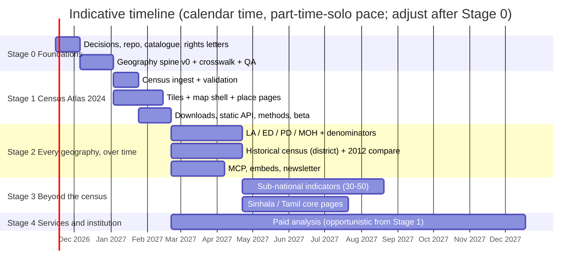
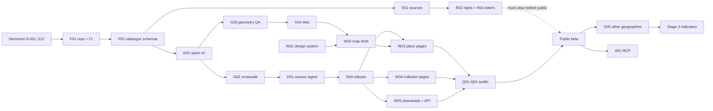
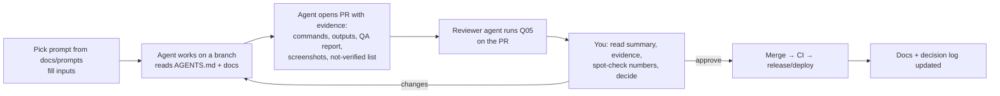

# Development strategy

Status: **proposed** · 2026-11-07 · Assumes: **one product/research lead (you), not coding day to day, working with AI agents; self-funded; no institutional relationships yet** (your answers, 2026-11-07).

---

## 1. Strategy in one paragraph

Go narrow and deep. Build the geography spine carefully, launch one excellent flagship (the Census Atlas 2024), and use it to earn credibility with journalists, researchers and NGOs. Credibility brings institutional access, partners and paid work, and paid work funds expansion. Size every stage to your **verification capacity**, not to what agents can generate. Reuse the ecosystem's raw data where it is reliable, and spend your effort where nobody else does: harmonisation, geography, provenance and explanation.

---

## 2. Stages at a glance

| Stage | Goal | Indicative duration ❓ | Exit criteria |
|---|---|---|---|
| **0. Foundations** | Decisions made; a verified geography spine | 6–8 weeks | Spine v0 with QA report; DS/GN discrepancies listed; rights letters sent; repo, CI and catalogue working |
| **1. Census Atlas 2024 (public beta)** | One flagship that proves the whole chain | 10–14 weeks | Public beta live; accuracy audit passed; 10+ named people from target audiences have used it; first citation or press mention |
| **2. Every geography, over time** | Non-nesting geographies, denominators, history; distribution channels | 4–5 months | LA, ED/PD and MOH profiles; historical district series; MCP server; embeds used by at least one outlet; one paid pilot |
| **3. Beyond the census** | Curated sub-national indicators; trilingual core | 4–6 months | 30–50 verified indicators across 5+ topics; Sinhala/Tamil core pages; data release calendar |
| **4. Services, products, institution** | Sustainable revenue and formal partnerships | Ongoing (paid work can start in Stage 1) | Recurring revenue covering running costs; first MoU or data feed; organisational structure decided |

Durations are estimates for a solo lead at a steady part-time to full-time pace with AI agents. Re-estimate at the end of Stage 0, when you know your real verification throughput.

---

## 3. Stage detail

### Stage 0: Foundations (6–8 weeks)

**Deliverables**
1. Decisions confirmed (vision §10; decision-log entries D-001 to D-015).
2. Repository bootstrapped: monorepo, AGENTS.md, CI (lint, test), Python package skeleton, Next.js skeleton, R2 buckets (F01).
3. Catalogue schemas and validator; first 10–15 source files (F02, R01).
4. Rights investigation for COD-AB, DCS Census 2024, NSDI and OSM. **Letters drafted for you to send** to DCS (reuse terms) and the Survey Department/NSDI (boundary currency and terms) (R02, R04).
5. **Geography spine v0**: COD-AB levels 0–4 ingested; hierarchy fixed and validated; crosswalk to DCS census unit lists (via the Census 2024 tables), NSDI attributes and Lanka Data Layer; QA report published internally (G01–G03).
6. Upstream goodwill: report the Ampara parent bug to Lanka Data Layer with evidence; introduce yourself to nuuuwan and LDF with a short, specific note (R04).
7. Brand basics: domain secured, one-page charter with governance principles, name check.
8. Claims model (D-019): schemas allow several sources per value, with a preferred claim and reason.
9. Spatial and vector foundations (D-013, D-016): the `spatial` block and `VECTOR_SPACE` schema in the catalogue (F02); the contiguity graph and `geo` coordinates built with the spine (G01).

**Not in Stage 0:** any public website, statistics beyond the census unit lists, design polish.

**Your personal work:** decisions, sending letters, reviewing the QA report, a 1–2 hour boundary spot-check in QGIS (the agent prepares a project file for you).

### Stage 1: Census Atlas 2024 (10–14 weeks)

**Deliverables**
1. Census 2024 GN-level topic tables and final-report tables ingested, harmonised and validated against published totals (D01, D02 for PDF tables).
2. Release `v2027.MM.1`: Parquet/CSV/GeoPackage, `datapackage.json`, changelog, QA report (D04).
3. Boundary PMTiles and Sri Lanka basemap extract (G04).
4. Spatial context (D-015, D06, A03): neighbour, parent and national comparison for every value; clusters and outliers for core indicators; small-number handling; the `profile` vector space for places and indicators, with "places like this" explained exactly by indicator contributions (D-016).
5. "Sources disagree" panel (D-019) for unit counts and census totals where DCS, COD-AB, NSDI and others differ.
6. Web: design system and performance budget (W01), persistent map shell and explorer (W02), place pages (W03), indicator pages and charts (W04), downloads and static API (W05), place search (W06).
7. Content: methodology page, sources pages, corrections log, 2–3 explainers (C01, C02).
8. Quality: accuracy audit (Q01), performance (Q02), accessibility (Q03), security review (Q04).
9. Launch: soft launch to 20–30 hand-picked users (journalists, researchers, NGO analysts), collect feedback, then public beta.
10. Customer discovery: 8–10 conversations with potential paying users (R05).

**Exit gate:** do not go public until Q01 passes. A visibly wrong number on launch day costs more than a month's delay.

### Stage 2: Every geography, over time (4–5 months)

1. Non-admin geographies: local authorities, electoral districts and polling divisions, MOH areas, each composed of GNs with weights, plus population denominators (G05). Resolve the provenance of the boundaries first (R01/R02).
2. History: district-level census series 1871–2024 where published; 2012↔2024 comparison at DS level with a boundary crosswalk (G06).
3. Election atlas: results by polling division and electoral district across election types, presented neutrally with turnout and the official source; linked to census profiles through GN composition ([design §3](../architecture/live-events-and-sources.md#3-election-results)).
4. Distribution: MCP server and `llms.txt` (A01), AI evaluation set (A02), embeddable maps and charts, a monthly "Sri Lanka in numbers" newsletter.
5. Power users: a DuckDB-WASM or Datasette explorer over release Parquet.
6. First paid pilot (S02), for example a sampling frame or catchment analysis for an NGO or research firm.
7. Spatial analytics v2 (D-014, D-015): GN-to-hex weights (G07); drawn, radius and multi-unit areas computed in the browser; typology v1; `trajectory` space (change vectors 2012→2024); `text` space for search; `composite` space with sliders; two-map explorer (W08); scale check.
8. Feature layer v1 (D-017, G08): buildings, landmarks and POIs, land cover; feature roll-ups as a new GN profile block; "what's here" on GN pages; point resolver. Legal checks on map publication and ODbL aggregates first.

### Stage 3: Beyond the census (4–6 months)

1. 30–50 curated sub-national indicators across 5+ topics, chosen by public value × availability × verification cost. Candidates: poverty (HIES), labour (LFS district), education (school census), health facilities (Annual Health Bulletin), dengue by MOH, paddy production by district and season, foreign employment by district (SLBFE), tourism, disasters (DMC).
2. Freshness monitor and public data release calendar (D05).
3. Sinhala and Tamil versions of core pages and indicator names (W07), with human translators reviewing.
4. National context strip: a small set of CBSL/DCS national series shown beside places, not as a separate product.
5. Decide on a dynamic API (S01) based on real requests logged since Stage 1.
6. Points and access: facility features, OSM road network, travel time; landscape block; satellite-embedding experiment; natural-language spatial queries (after A01).
7. Feature layer v2: canopy and derived tree crowns (labelled modelled), terrain, `form` and `context` spaces, feature-level similarity on the serving layer.

### Stage 3 track: "Living Sri Lanka" (scheduled feeds, D-020)

Runs alongside Stage 3 once releases are routine: weather history and forecasts, rainfall, disaster reports, disease, reservoir levels, prices, night lights; an events layer; a GDELT news experiment; place timelines. Each feed passes a rights check first ([design §4](../architecture/live-events-and-sources.md#4-live-and-historical-feeds-stage-3-d-020)).

### Stage 4 track: "Movement"

Estimated train positions from timetables (labelled as scheduled, not live), aircraft from open feeds where terms allow, bus data only through partnerships; the first streaming server component ([design §5](../architecture/live-events-and-sources.md#5-movement-traffic-buses-trains-aircraft-stage-4)). Social media signals stay a research track pending lawful access and an ethics review.

### Stage 4: Services, products, institution

- Productise repeat paid work, for example a sampling-frame builder, catchment or market-sizing reports, or a resolver API (coordinates → GN/DS/LA/MOH IDs) with a service-level agreement.
- Formal partnerships: errata channel with DCS, data feeds, MoUs.
- Fine-scale partnerships: parcel geometry from the Survey Department (no personal data), official facility registers, municipal tree inventories, sub-metre imagery through a grant, joint mapping with the OSM Sri Lanka community.
- Organisational structure: decide whether to add a non-profit arm based on funding reality (see [organisation-and-business-model.md](../vision/organisation-and-business-model.md)).
- Long-term opportunities from the [register](../ideas/opportunities-register.md): satellite-derived indicators, access to services, historical geography, address normalisation.

---

## 4. Dependencies and what can run in parallel

**Parallel tracks** (independent; can be separate agent sessions):
- W01 (design system) can start during Stage 0. It needs only sample data.
- R-series research and letters run alongside all engineering.
- G03 (geometry QA) and G02 (crosswalk) run in parallel after G01.
- C-series content can be drafted once the release exists.

**Strictly sequential:** spine → census harmonisation → release → pages. Rights clearance → public launch.

---

## 5. Working as a non-coding lead with AI agents

### The loop

### What only you should do
- Make the decisions in the decision log; agents propose, you approve.
- Verify key numbers against source documents (the verification sheet makes this fast).
- Send outward-facing messages: letters, emails, RTI requests, posts. Agents only draft.
- Approve licences and rights positions.
- Edit and approve explainers before publication.
- Talk to users and customers.

### Where to buy occasional expert help (strongly recommended)

| Help | Why | Indicative effort |
|---|---|---|
| Senior software engineer, part-time reviewer | Catches architectural drift and security issues agents miss; reviews the release pipeline and auth later | 4–6 h/month |
| GIS specialist (ideally Sri Lankan, familiar with Survey Dept data) | Boundary verification, DS/GN reconciliation, CRS issues | 10–20 h in Stage 0–1, then occasional |
| Sinhala and Tamil translators/reviewers | Names and core pages | Stage 1 (names), Stage 3 (pages) |
| Lawyer (Sri Lankan) | Data rights, PDPA, terms of use, company formation | A few hours at Stage 0 and before launch |

### Guardrails for agents (in AGENTS.md)
Never fabricate; evidence for every claim; no writes to production storage except through CI; no outward-facing actions; small PRs; tests with real output; update docs and the decision log.

---

## 6. Budget (indicative, self-funded) ❓

All figures are rough monthly estimates in USD. Verify current pricing before committing.

| Item | Stage 0–1 | Stage 2–3 | Notes |
|---|---|---|---|
| Hosting (Vercel Pro, R2, Cloudflare) | 20–30 | 25–60 | Grows mainly with traffic to the web app |
| AI agents (Claude) | 100–200 | 100–300 | Your main running cost; depends on plan |
| Domain(s) | ~2 | ~2 | `.com` may cost more if bought from a reseller |
| Expert help (from §5) | 150–600 | 150–600 | Optional but recommended |
| Legal (one-off) | 300–1,000 total | — | Company setup, terms, data-rights opinion |
| **Total running** | **~120–850/month** | **~280–1,000/month** | The low end is achievable without expert help |

The largest real cost is **your time**. The plan assumes 20–40 focused hours per week.

---

## 7. Risks specific to this plan

| Risk | Likelihood | Impact | Mitigation |
|---|---|---|---|
| DCS reuse terms restrict republishing census tables | Medium ❓ | High | Ask early. Design the release to attribute DCS clearly. Fall back to "view with attribution, link to the DCS download" if needed. |
| Boundary mismatches (DS/GN counts) block joins | High | Medium | Crosswalk with explicit unmatched lists. Publish what matches; flag the rest. Ask the Survey Department. |
| Verification bottleneck (solo) | High | High | Verify only key figures by hand, spot-check samples, label honestly, automate cross-checks. |
| Scope creep from exciting ideas | High | High | Opportunities register plus stage gates. New ideas wait for an M01 evaluation. |
| AI agents introduce subtle errors | Medium | High | Validation gates, reviewer-agent prompt, accuracy audit before release, part-time human reviewer. |
| A better-resourced player builds the same thing (LDF, LDL) | Medium | Medium | Collaborate early; specialise in place-based harmonisation; move steadily. |
| Burnout or bus factor (solo) | Medium | High | Sustainable pace; documented decisions and prompts so others can pick up; public repos. |
| Political sensitivity (ethnicity, religion, elections) | Medium | Medium | Neutral presentation, official sources, no rankings that imply judgement, editorial policy published. |
| Online Safety Act exposure | Low–Medium ❓ | Medium | Legal check before launch; factual, sourced content only. |

---

## 8. Metrics by stage (credibility first)

- **Stage 1:** accuracy audit pass rate; number of named expert users; citations and mentions; time to find a GN figure.
- **Stage 2:** embeds in the wild; API and MCP calls; newsletter subscribers; first paid pilot.
- **Stage 3:** verified indicators; share of values `human_verified` or `reconciled`; corrections turnaround; Sinhala/Tamil usage.
- **Stage 4:** recurring revenue against running costs; partnerships; repeat clients.

---

## 9. First 30 days: concrete checklist

1. [ ] Read the vision and decide the §10 questions; mark decisions in the decision log.
2. [ ] Buy the domain(s). Check NIPO trademark search and business-name availability.
3. [ ] Create the GitHub organisation and repository; run **F01** (bootstrap).
4. [ ] Run **F02** (catalogue schemas), then **R01** for: COD-AB, DCS Census 2024, NSDI, OSM/Protomaps, Lanka Data Layer, nuuuwan census repository.
5. [ ] Run **R02** on DCS Census 2024 and COD-AB; run **R04** to draft letters to DCS and the Survey Department; **send them yourself**.
6. [ ] Run **R04** for a short note to Lanka Data Layer about the Ampara bug (with evidence from the audit); send it yourself.
7. [ ] Run **G01** (spine v0), then **G02** and **G03** in parallel sessions.
8. [ ] Review the QA report; do a 1-hour QGIS spot-check with the project file the agent prepares.
9. [ ] Start **W01** (design system spike) in parallel once the spine exists.
10. [ ] Hold a Stage 0 retrospective (**M02**): re-estimate Stage 1 using real throughput.
